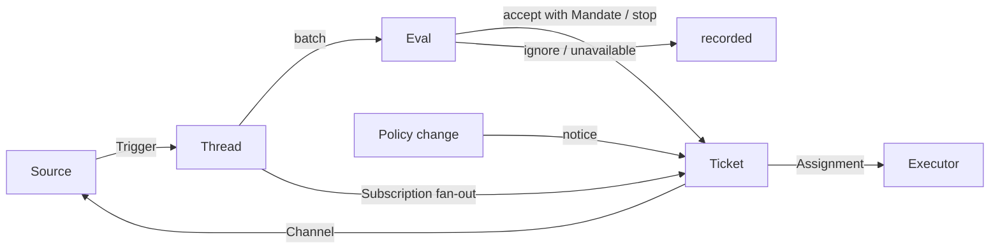

# 001 领域模型

本文为 dsh-superagent-cn 的概念命名，并给出每个概念遵守的规则。代码、智能体调用的工具、管理面板和其余文档只用这些术语。遵循 [000 哲学](000-philosophy.md)，模型只保留工作需要的概念，一项业务需求成为其中之一的属性。

## 流转

工作从触发到评估再到执行。Source 产生触发。一个触发作为上下文扇出到订阅了其线程的工单。人的消息经由这条路到达某个工单后留在该工单；其余每个触发进入评估，由评估决定它是否请求新工作。评估接受时，它创建一个带授权的工单。派工把工单交给一个执行器，结果经渠道回到 Source。

## 概念

Source、线程、评估、授权与订阅构成核心领域；其余概念支撑它们。

| 概念 | 定义 | 遵守的规则 | 为什么存在 |
| --- | --- | --- | --- |
| Source | 一条事件流。Source kind 是可复用的实现；Source instance 是一个 kind 的一份配置：是否运行、监听什么 | 保存自己的读取位置和自己的机器人身份。定义什么算作事件，包括只在时间上成立的条件。在进入领域之前丢弃机器人自己的消息和超出监听范围的触发。把每个触发翻译成它所属的线程和可回复的渠道地址 | 重启不得重放事件 |
| 触发（Trigger） | 一条不可变事件，带 Source 自己的元数据，例如其行为人 | 属于一个或多个线程。同一触发被接受两次只产生一个工单 | 审计与幂等的单位 |
| 线程（Thread） | 按时间排序的触发；由 Source 定义哪些触发构成一个线程 | 同一时刻至多一个评估在其上运行。它可以有多个工单。保存其订阅、运行中的评估和决定历史 | 给评估一个一致的视图及其上下文 |
| 关联（Correlation） | 一个触发所属的多个线程之间的关系 | 只添加上下文；绝不路由 | 让评估能追踪相关证据 |
| 渠道（Channel） | 线程的写侧；由 Source 定义其地址 | 一个线程可以有多个渠道；工单持有一组渠道 | 确认、回复、拉取请求和已解决的评审都是写 |
| 策略（Policy） | 有版本的评估规则，以及每个 Source 的部分：谁可以经该 Source 发起工作、以该 Source 自己的哪些身份、名单如何同步、哪些机器人可以产生候选 | 策略版本覆盖规则、接受模式和 Source 部分。影响在跑工单的变更（例如其接受所依据的规则变了）会投递给它的派工；不撤销授权。不同 Source 上的身份永不互相映射 | 规则变化时，正在运行的评估必须作废 |
| 评估（Eval） | 对一批触发的判断，分两层：准入与研判 | 输入：触发批次、线程快照、线程上的每个工单（含已结束的）和当前策略。输出：一个决定。不持有状态 | 决定新工作是否开始、继续或停止 |
| 授权（Mandate） | 一次接受所授予的东西：策略版本、范围、强度、匹配的规则、发送者在该 Source 上的身份，以及 Source 如何收到该触发 | 不可变；更宽的范围意味着新工单。工单结束不结束它：只有人的停止会撤回它，不再满足它的策略会吊销它。已结束工单恢复前要对照当前策略重新校验 | 说明工作为什么可以做，以及可以做到哪 |
| 工单（Ticket） | 一份获授权的工作单元 | 只有评估能创建。引用其授权；持有其渠道与输入。从开启到结束，当人的一条消息在其某个线程上恢复它时回到开启，除非是人停止了它。定义自己的状态，不跟随执行器的 | 拥有执行过程及其报告 |
| 派工（Assignment） | 工单与一个执行器实例的绑定 | 一个工单随时间有多个派工。独立于工单地经历待启动 → 执行中 → 已结束。只有它的最终报告可以从执行器一侧结束工单 | 执行器在领域之外，但由谁执行必须在领域之内 |
| 订阅（Subscription) | 工单与线程之间的多对多关系，由线程持有 | 匹配的触发扇出到每个存活的已订阅工单，不检查发送者；人的消息这样到达工单时不做评估。执行器为上下文而关注的线程以同样方式到达其工单，但不借出授权，也不恢复它。已结束的工单保留其订阅，包括已关闭或已合并拉取请求的：人的消息以同一授权恢复它，没有评估或决定；机器人和 CI 的消息不会到达它，因为其执行器恢复时会重新读取其线程。被人停止的工单什么也不接收。主 Session 只有在消息明确指向某个工单时才把线程挂到已有工单。人可以移除一个线程上的全部订阅；执行器只能移除自己工单对它认为无关的线程的订阅，但其工单起始的线程和 Source 要求它关注的线程（例如其拉取请求的）除外 | 后续讨论无需再次提及智能体即可到达执行器 |

人不是领域概念。触发以 Source 给出的形式携带其行为人的标识。允许名单是策略的 Source 部分，用该 Source 自己的身份。"同一个人在多个 Source 上有账号"是智能体在需要时阅读的提示词文本。

执行器及其会话与目录在领域之外，通过派工接入。

聚合：Source 保存其读取位置。线程保存其订阅、运行中的评估（串行运行，把期间到达的触发合并进下一批）和决定历史。工单保存其派工、渠道与输入，按 id 引用决定。

## 被否决的概念

| 被否决 | 理由 |
| --- | --- |
| 把委托人或成员关系做成实体，或跨 Source 映射身份 | 人是触发元数据；允许名单是策略的 Source 部分；跨 Source 映射是提示词文本 |
| 评估调度自己的延迟触发 | 需要等待的条件就是一个普通的 Source，评估绝不反向依赖 Source |
| 等待中或已吊销的评估状态 | 等待属于 Source；超时的评估把其触发重新排队，或以 `unavailable` 结束 |
| 每个线程至多一个存活工单 | 一个线程可以承载多件独立的工作；研判借工单列表避免重复 |
| "追加到工单"决定 | 追加就是订阅扇出，不需要评估 |
| 对订阅做准入检查 | 订阅覆盖整个线程；授权把授权与上下文分开 |
| 会路由的关联 | 订阅负责路由；关联只添加上下文 |
| 跟随 DSH Session 的工单状态 | 工单可以被交接、恢复或由多个执行器运行，所以它定义自己的状态 |
| 执行器宣称是人让它停止的 | 只有评估决定一次结束的强度 |
| 策略变更时取消在跑的工单 | 取消会留下半成品；变更是被记录并投递的 |
| 执行器 Session 失败或阻塞时锁死其全部工具 | 那会拒绝在 Session 中直接工作的人，也拒绝恢复后的报告；暂停自动输入就够了 |
| 从报告的自由文本推断"在等人" | 分类需要结构化事实；执行器通过结构化字段提问 |

## 可复用的部分

上述概念及其规则可复用。Source 的实现、策略的内容、执行器与渠道的实现属于具体部署。每个 Source 内部保留自己的词汇，例如消息、聊天或通知，并把它们翻译成触发。

| 部分 | 本仓库中的实现 |
| --- | --- |
| Source | 飞书：实时事件、历史恢复、订阅话题的轮询。GitHub：通知、被订阅的 Issue 与拉取请求、CI 变化、拉取请求被合并或关闭，以及在开启时，仓库内每个新 Issue、拉取请求和评论及默认分支的 CI |
| 策略 | 评估规则，以及每个 Source 的允许名单、其同步方式、机器人名单和准入表 |
| 执行器 | 每 Ticket 一个 DSH 执行器 Session 和一个目录，处于一个由执行器与 Source 注册变量的执行环境中 |
| 渠道 | 飞书话题回复、GitHub 评论与评审线程回复 |

## 术语表

本文与后续文档所用术语的对照表，附中文名；上文未介绍的术语由后续文档解释。面板一次显示一种语言；其（?）按钮会以双语打开本术语表。智能体在 GitHub 和飞书上给人发的消息使用平实语言，不用这些术语。

| Term | 中文 | Meaning |
| --- | --- | --- |
| Agent | 智能体 | The automated team member dsh-superagent-cn runs, acting on Sources through identities such as a GitHub account and a Feishu bot |
| Main Session | 主 Session | The DSH Session that evaluates Triggers, accepts and dispatches Tickets, and replies; `orchestrator` in code and prompts |
| Executor Session | 执行器 Session | The DSH Session an Executor runs for one Ticket; `worker` in code and prompts |
| Source | 来源 | A stream of events: a kind that a plugin provides, plus one instance configuration |
| Trigger | 触发 | One immutable event from a Source |
| Thread | 线程 | Triggers in time order; the unit within which Evals run one at a time |
| Correlation | 关联 | The relation between Threads that share a Trigger; it adds context only |
| Channel | 渠道 | The write side of a Thread |
| Policy | 策略 | The versioned rules for accepting work, and each Source's part of it, such as who may ask for work there |
| Policy version | 策略版本 | The identifier of one combination of rules, Source parts and accept mode; every Mandate records it |
| Eval | 评估 | The process that turns a batch of Triggers into a Decision |
| Gate | 准入 | The deterministic first layer of Eval: who may originate work, and with what strength |
| Assessment | 研判 | The model's judgement during Eval |
| Decision | 决定 | The result of Eval |
| Mandate | 授权 | What an accept grants: strength, scope and the Policy version it relied on |
| Ticket | 工单 | A unit of authorized work |
| Assignment | 派工 | The binding of a Ticket to one Executor instance |
| Subscription | 订阅 | The relation between a Ticket and a Thread |
| Fan-out | 扇出 | Delivering Triggers of a subscribed Thread to a Ticket as context |
| Executor | 执行器 | The port that runs Assignments: one Executor Session and one directory per Ticket |
| Execution environment | 执行环境 | Where Executor Sessions and the prepare command run: variables that the Executor and the Sources register, each with a key, a value and a description |
| Report | 报告 | The state an Assignment reports to its Ticket |
| Attention | 待人工决定 | A question on a Ticket that waits for a person's answer |
| Disposition | 去向 | The record of a Trigger being filtered, evaluated or fanned out |
| Input | 输入 | Context delivered to a Ticket: fanned-out Triggers, Policy changes, resumes and text |
| Scope | 范围 | The work a Mandate allows |
| Strength | 强度 | How strong the basis of a Mandate or an Eval is |

| Group | Values |
| --- | --- |
| Decision | accept 接单 · stop 停止 · ignore 忽略 · unavailable 未完成 |
| Strength | explicit 明确 · inferred 推断 |
| Assignment | pending 待启动 · running 执行中 · ended 已结束 |
| Report | progress 进展 · waiting 等待 · ready 就绪 · blocked 受阻 · failed 失败 · dropped 无需处理 |
