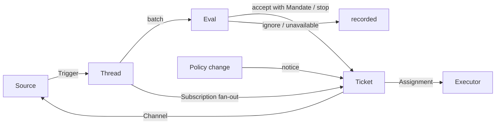

# 001 领域模型

本文给出 dsh-superagent 的概念命名，以及每个概念所遵守的规则。代码、智能体调用的工具、面板以及其他文档都只使用这些术语，不使用其他说法。遵循 [000 哲学](000-philosophy.md)，模型只持有一项工作真正需要的概念，而一个业务需求会成为其中某个概念的属性。

## 流程

工作从触发流向评估，再流向执行。来源产出触发。一个触发会作为上下文扇出到订阅了它所属线程的工单。以这种方式到达某个工单的人的消息会留在该工单上；其他所有触发都进入评估，由评估决定是否请求新工作。当评估接受时，它会创建一个带授权范围的工单。派工把工单交给执行器，结果则通过渠道回到来源。

## 概念

来源、线程、评估、授权范围和订阅构成核心领域；其余概念为它们提供支撑。

| 概念 | 定义 | 遵守的规则 | 存在的原因 |
| --- | --- | --- | --- |
| 来源 | 一条事件流。来源类型是可复用的实现；来源实例是某个类型的一份配置：是否运行、监听什么 | 持有自己的读取位置和自己的机器人身份。定义什么算一次事件，包括只在时间推移后才成立的条件。在进入领域之前丢弃机器人自己的消息，以及不在其监听范围内的触发。把每个触发翻译成它所属的线程和应当回复的渠道地址 | 重启不得重放事件 |
| 触发 | 一个不可变事件，带有来源自己的元数据，例如它的操作者 | 属于一个或多个线程。同一个触发被接受两次只创建一个工单 | 审计与幂等的单位 |
| 线程 | 按时间排序的触发；由来源定义哪些触发构成一个线程 | 同一时刻最多运行一个评估。它可以有多个工单。它持有自己的订阅、正在运行的评估及其决策历史 | 为评估提供一致的视图和上下文 |
| 关联 | 同一个触发所属线程之间的关系 | 只增加上下文；从不负责路由 | 让评估能够追踪相关证据 |
| 渠道 | 线程的写入侧；地址由来源定义 | 一个线程可以有多个渠道；一个工单持有一组渠道 | 确认、回复、拉取请求和已解决的评审都属于写入 |
| 策略 | 带版本的评估规则，以及各来源对应的部分：谁可以通过该来源发起工作、以该来源自己的身份、列表如何同步，以及哪些机器人可以产生候选 | 策略版本覆盖规则、接受模式和来源部分。影响在办工单的变更，例如修改某个工单被接受时所依据的规则，会投递给它的派工；但不会撤销授权范围。不同来源上的身份永远不会互相映射 | 规则变化时，正在运行的评估必须被丢弃 |
| 评估 | 对一批触发所做的判断，分为两层：准入与研判 | 输入：触发批次、线程快照、该线程上的所有工单（包括已结束的工单），以及当前策略。输出：一个决策。不持有状态 | 决定新工作是开始、继续还是停止 |
| 授权范围 | 一次接受所授予的内容：策略版本、范围、强度、匹配的规则、发送者在该来源上的身份，以及来源如何收到该触发 | 不可变；范围更宽意味着新工单。工单结束并不会结束它：只有人的停止才能撤回它，而不再持有它的策略会撤销它。已结束的工单恢复之前要针对当前策略重新校验 | 说明工作为什么可以被做，以及可以做到多远 |
| 工单 | 已授权工作的单位 | 只有评估可以创建工单。引用其授权范围；持有其渠道和输入。状态走 open → ended，当人在其某个线程上发消息使其恢复时回到 open，除非该人已将其停止。它定义自己的状态，而不跟随执行器的状态 | 拥有执行过程及其报告 |
| 派工 | 把工单绑定到一个执行器实例 | 一个工单随时间可以有多次派工。状态独立于工单走 pending → running → ended。只有它的最终报告才能在执行器一侧结束该工单 | 执行器在领域之外，但谁在执行必须在领域之内 |
| 订阅 | 工单与线程之间的多对多关系，由线程持有 | 匹配的触发会扇出到每个在办且已订阅的工单，不检查是谁发出的；以这种方式到达工单的人的消息不经过评估。执行器为获取上下文而关注的线程也以同样方式到达其工单，但不赋予它任何权限，也不使其恢复。已结束的工单保留其订阅，包括已关闭或已合并的拉取请求的那条订阅：人的消息会在同一授权范围下使其恢复，不经过评估或决策；来自机器人和 CI 的消息不会到达它，因为其执行器在恢复时会重新读取自己的线程。被人停止的工单不会收到任何东西。主会话只有在消息明确指向某个工单时，才把线程附加到该工单。人可以丢弃一个线程上的所有订阅；执行器只能丢弃自己工单针对某个它认为无关的线程的订阅，例外是其工单起始所在的线程，以及来源使其关注的线程，例如其拉取请求所在的线程 | 后续讨论无需任何人再次提到智能体即可到达执行器 |

人不是领域概念。触发携带其操作者的标识符，由来源按自己的方式给出。允许列表是策略中某个来源的部分，使用该来源的身份。某个人在多个来源上都有账号这一事实，是智能体在需要时读取的提示词文本。

执行器及其会话与目录位于领域之外，通过派工与领域相连。

聚合：来源持有它的读取位置。线程持有它的订阅、正在运行的评估（以串行方式运行，并把期间到达的触发并入下一批）以及它的决策历史。工单持有它的派工、渠道和输入，并按 id 引用决策。

## 被否决的概念

| 被否决的概念 | 原因 |
| --- | --- |
| 把主体或成员关系作为实体，或跨来源映射身份 | 人是触发的元数据；允许列表是策略中某个来源的部分；跨来源映射是提示词文本 |
| 由评估自行调度延迟触发 | 需要等待的条件就是一个普通来源，因此评估从不反向依赖来源 |
| 等待中或已撤销的评估状态 | 等待属于来源；超时的评估会重新排队它的触发，或以 `unavailable` 结束 |
| 每个线程最多一个在办工单 | 一个线程可以承载多项独立工作；研判会依据工单列表避免重复 |
| 「追加到工单」的决策 | 追加就是订阅扇出，不需要评估 |
| 对订阅做准入检查 | 订阅覆盖整个线程；授权范围把授权与上下文分开 |
| 会路由的关联 | 订阅负责路由；关联只增加上下文 |
| 跟随 DSH 会话的工单状态 | 工单可以被转交、恢复，或被多个执行器运行，因此它定义自己的状态 |
| 执行器声明有人要求它停止 | 只有评估可以决定某次结束处于什么强度 |
| 策略变更时取消正在运行的工单 | 被取消的变更会留下半成品；变更应当被记录并投递 |
| 执行器会话失败或阻塞时锁定其所有工具 | 这会拒绝在该会话中直接工作的人，也会拒绝恢复之后的报告；暂停自动输入就足够了 |
| 从报告的自由文本中推断「等待某人」 | 这种分类需要结构化事实；执行器通过结构化字段来询问 |

## 可复用的部分

上述概念及其规则是可复用的。来源实现、策略内容、执行器和渠道实现属于某个具体部署。每个来源在内部保留自己的说法，例如 message、chat 或 notification，并把它们翻译成触发。

| 部分 | 在本仓库中 |
| --- | --- |
| 来源 | 飞书：实时事件、历史恢复、订阅话题的轮询。GitHub：通知、已订阅的 Issue 和拉取请求、CI 变化、已合并或已关闭的拉取请求，以及在开启的情况下，仓库中每个新的 Issue、拉取请求和评论，以及默认分支的 CI |
| 策略 | 评估规则，以及每个来源的允许列表、它的同步、它的机器人列表和它的准入表 |
| 执行器 | 一个 DSH 执行器会话，以及每个工单一个目录；其运行环境中的变量由执行器和来源注册 |
| 渠道 | 飞书话题回复、GitHub 评论和评审线程回复 |

## 术语表

本文及后续文档所用术语的对照表，附其中文名称；后续文档会解释上文未引入的术语。面板一次只显示一种语言；它的 (?) 按钮会用两种语言打开本术语表。智能体在 GitHub 和飞书上发给人的消息使用平实语言，不使用这些术语。

| 术语 | 中文 | 含义 |
| --- | --- | --- |
| Agent | 智能体 | dsh-superagent 运行的自动化团队成员，通过 GitHub 账号、飞书机器人等身份在来源上行动 |
| Main Session | 主 Session | 评估触发、接受并分派工单、进行回复的 DSH 会话；在代码和提示词中称为 `orchestrator` |
| Executor Session | 执行器 Session | 执行器为一个工单运行的 DSH 会话；在代码和提示词中称为 `worker` |
| Source | 来源 | 一条事件流：由插件提供的一种类型，加上一份实例配置 |
| Trigger | 触发 | 来自来源的一个不可变事件 |
| Thread | 线程 | 按时间排序的触发；评估在其中一次只运行一个的单位 |
| Correlation | 关联 | 共享同一个触发的线程之间的关系；只增加上下文 |
| Channel | 渠道 | 线程的写入侧 |
| Policy | 策略 | 接受工作的带版本规则，以及每个来源在其中所占的部分，例如谁可以在那里请求工作 |
| Policy version | 策略版本 | 规则、来源部分与接受模式某一组合的标识符；每个授权范围都会记录它 |
| Eval | 评估 | 把一批触发转化为一个决策的过程 |
| Gate | 准入 | 评估中确定性的第一层：谁可以发起工作，以及以什么强度 |
| Assessment | 研判 | 评估过程中模型做出的判断 |
| Decision | 决策 | 评估的结果 |
| Mandate | 授权范围 | 一次接受所授予的内容：强度、范围以及它所依据的策略版本 |
| Ticket | 工单 | 已授权工作的单位 |
| Assignment | 派工 | 把工单绑定到一个执行器实例 |
| Subscription | 订阅 | 工单与线程之间的关系 |
| Fan-out | 扇出 | 把已订阅线程的触发作为上下文投递给工单 |
| Executor | 执行器 | 运行派工的端口：每个工单一个执行器会话和一个目录 |
| Execution environment | 执行环境 | 执行器会话和 prepare 命令所运行的地方：由执行器和来源注册的变量，每个变量都有键、值和描述 |
| Report | 报告 | 派工向其工单报告的状态 |
| Attention | 待人工决定 | 工单上等待某人作答的问题 |
| Disposition | 去向 | 某个触发被过滤、被评估或被扇出的记录 |
| Input | 输入 | 投递给工单的上下文：扇出的触发、策略变更、恢复和文本 |
| Scope | 范围 | 授权范围所允许的工作 |
| Strength | 强度 | 授权范围或评估的依据有多强 |

| 分组 | 取值 |
| --- | --- |
| Decision | accept 接单 · stop 停止 · ignore 忽略 · unavailable 未完成 |
| Strength | explicit 明确 · inferred 推断 |
| Assignment | pending 待启动 · running 执行中 · ended 已结束 |
| Report | progress 进展 · waiting 等待 · ready 就绪 · blocked 受阻 · failed 失败 · dropped 无需处理 |
