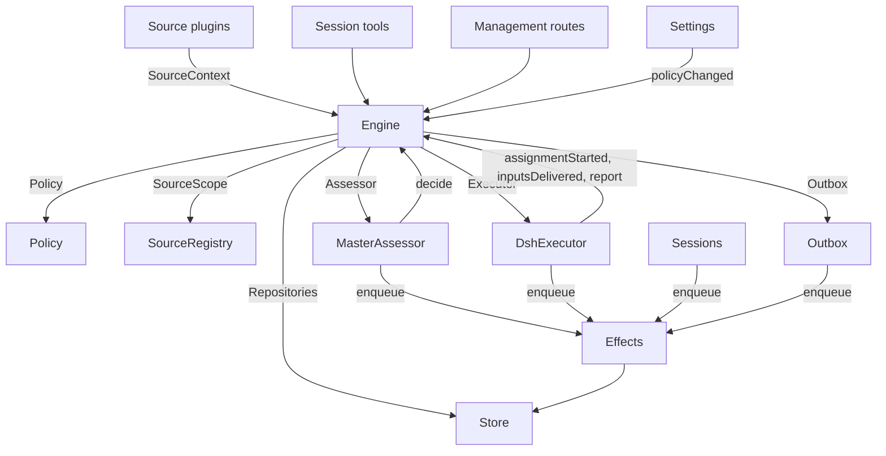

# 007 架构

这是实现的开发者指南。它把 [001 领域模型](001-domain.md) 到 [006 部署](006-deployment.md) 中的概念映射到类、接口与文件。先从运行时与引擎开始，然后把模块表和测试表当作代码索引使用。

## 核心类与粘合层

核心类在小接口背后持有领域概念与外部边界。粘合层把工具参数、HTTP 请求、来源（Source）负载和 DeepSeek Harness 事件翻译成对这些类的调用，再把结果变成卡片、视图与消息。

`Runtime`（`src/app/runtime.ts`）构造应用、提供依赖，并负责启动与关闭。`Engine` 构造自己的内部部件。执行器与评估器会回调引擎，因此运行时交给它们的是 getter，而不要求按会形成循环的顺序构造。

### 运行时

`Runtime` 是组合根；它不包含领域规则。它的构造函数锁定状态目录、打开存储（Store）并构建每个组件。若构造失败，它会关闭存储并释放锁。

启动时注册管理路由并运行 Setup。Setup 解析完成后，它安装会话与执行器钩子、确保主会话存在、启动策略同步、恢复被中断的任务分派，并启动轮次与副作用。`ready` 标记启动完成。

关闭时取消回合、等待轮次、副作用与智能体，恢复进程环境，关闭存储并释放锁。来源插件通过窄接口 `SourceHost` 把运行时注入为 `orchestrator` 服务。

| 部件 | 模块 | 作用 |
| --- | --- | --- |
| Setup | `src/app/setup.ts` | 按 worker shell 的实际运行方式探测各 CLI，解析仓库与账号，写入并应用 worker 的环境与命令 shim，并保留 setup 问题；设置通过它检查变更后的账号，也通过它重启，重启会再次运行 setup |
| Passes | `src/app/passes.ts` | 一次只跑一个轮次，每两秒一次，并在任何命令要求时运行：先处理到期副作用，再调用 `Engine.evaluateDue`；来源的触发通过它到达引擎 |
| Outbox | `src/app/outbox.ts` | 引擎的 `Outbox` 端口，也是回执的唯一写入者：`send` 在同一事务中保存消息回执并排队其 `reply` 副作用，副作用的处理器通过 `SourceRegistry.send` 发送；来源关闭时消息等待，会话不存在或未被监听时消息被丢弃 |
| Notices | `src/app/notices.ts` | 把领域事件与 worker 活动转换成主会话消息。`eventNotice` 处理领域通知；`reportRelay` 立即转发问题、把普通进度留在其工单上，并转发其他汇报；`followupRelay` 指出拥有人工跟进的工单。回合进行中到达的转发会在下一步通过 DeepSeek Harness 收件箱一起投递 |

### 引擎

`Engine`（`src/core/engine.ts`）是触发、线程、决策、工单与任务分派的唯一写入者。它从 `src/core/ports.ts` 接收这些端口：`Repositories`、当前策略 getter、`SourceScope`、`Assessor`、`Executor` 与 `Outbox`。可选依赖是 `prepareTicket`、`now` 与 `emit`。

所有引擎方法都是同步的。每个命令在一个事务中修改其聚合。`evaluateDue` 为它修改的每个评估或工单使用单独的事务。端口在事务内排队外部工作；适配器在提交后执行。无效请求抛出 `UserError`。

引擎暴露一个入口，并委派给五个内部部件。它持有每个命令的事务。跨部件的命令，例如 `attach`、`evaluateDue` 与 `policyChanged`，按顺序调用这些部件。

每个部件都扩展 `EnginePart`（`src/core/part.ts`），后者提供选项与共享读取。部件之间的依赖单向流动：

| 部件 | 职责 | 依赖于 |
| --- | --- | --- |
| `Intake` | 来源的触发：连同其处置结果只存储一次，记录在其线程及其关联上，扇出给订阅的工单，并且，除非它是到达某个工单的人的消息，否则在其主线程上排队等待评估 | Tickets |
| `Evals` | 线程的评估：批处理、门禁的强度、参与者与依据及其来源触发（`primary`）、从候选投递起算的截止时间及其因暂停而产生的顺延、过期评估的重新排队、候选、重放与交回、策略变更时的重新排队，以及每次评估最终形成的决策：接受、停止、忽略或不可用 | Tickets |
| `Tickets` | 工单生命周期：由一次接受创建及其授权、订阅与首个任务分派、它跟随的线程及其关闭（`followsDone`）、附加线程与为上下文而跟随的线程、输入与备注、恢复及恢复所拒绝的消息、重试、重启、停止与结束、它放弃的订阅，以及策略变更通知它所涉及的工单 | Replies |
| `Assignments` | 执行器及其 worker 汇报的内容：任务分派已开始、输入已到达或未能到达、重启中断了它，以及 worker 的汇报及其向人提出的问题 | Tickets、Replies |
| `Replies` | 通过 `Outbox` 的渠道写入：确认、答复、结果与提醒消息，各自按允许它的规则发送 | 无 |

命令使用祈使名称，例如 `stopTicket`；适配器上报的事实使用过去时名称，例如 `assignmentStarted`。查询 `candidate` 使用名词。

调用方只收到其角色对应的引擎 `Pick`：`EngineForSources`、`EngineForMainSession`、`EngineForPeople`、`EngineForSettings` 或 `EngineForExecutor`。

| 角色 | 方法 | 效果 |
| --- | --- | --- |
| Sources | `receive(trigger)` | 只存储一次触发，并回答 `stored`、`duplicate`，或在没有任何来源接收它时回答 `filtered`；把它扇出给订阅其线程的工单，其中人的消息会立即恢复已结束的工单，除非处理已暂停；并在其主线程上排队等待评估，除非它是到达某个工单的人的消息，那种消息留在该工单 |
| Sources | `bindThread(ticketId, thread, own)` | 让打开的工单跟随来源的某个线程，例如拉取请求的线程，若该工单打开了它则 `own` 为真；再次绑定的已关闭线程会重新打开。结束工单的是这些线程的关闭，而不是一次 `ready` 汇报 |
| Sources | `threadClosed(thread, outcome, at)` | 某个线程已关闭：每个跟随它的打开工单记录这次关闭，并在它与其跟随的线程都处理完毕（`followsDone`）时结束：它打开的线程都未打开，或者，若它没有打开任何线程，则它跟随的每个线程都已关闭。它按这些关闭中最新的一个结束为 `merged` 或 `closed`，除非关闭后恢复的工作尚未汇报 `ready`，或其执行器在其最新一次非 `progress` 的汇报之后决定接手某个人工跟进（通过确认或答复它），或其最后一个回合结束；随后一次 `dropped` 汇报会像那次关闭一样结束它 |
| Main Session | `candidate(triggerId)` | 持有某个触发的评估，按其评估器所见的样子 |
| Main Session | `candidateDelivered(evalId)` | 该评估的候选已到达主会话：其截止时间从此刻起算 |
| Main Session | `decide(triggerId, outcome)` | 记录一次评估决策，或为显式请求记录一次直接决策。接受会原子地创建工单、授权、任务分派、订阅与确认。从卡片上被忽略的推断候选，会在给出的原因之前记录 `ignoredFromCard`。当 `followupOwners` 仍拥有人工跟进时，只允许停止 |
| Main Session | `attach(ticketId, triggerId, note?)` | 把触发路由到它指向的工单，该工单的执行器随后把它当作跟进进行决策，并结束持有它的评估，该评估的其他触发等待新的评估；已结束的工单会立即在其授权下恢复，除非处理已暂停。执行器仍在决策的跟进会被拒绝，被路由回交回它的那个工单的跟进也会被拒绝 |
| Main Session | `requestStatus(ticketId)` | 向等待中的执行器会话询问其状态，并回答是否已询问 |
| Main Session | `note(ticketId, text)` | 把来自其他工作的事实作为文本输入交给工单的执行器，这不授予任何权限 |
| Main Session, Executor | `reply(request)` | 为其用途指定的渠道排队一条消息：`acknowledgement`、`answer`、`result` 或 `attention` |
| People | `stopTicket(ticketId, reason?)` | 人的停止，会撤回授权 |
| People | `retryTicket(ticketId)` | 结束工单中停摆的任务分派——该工单在一次 `failed` 或 `blocked` 汇报后等待人，或其输入投递失败（`canRetry`）——并启动新的任务分派 |
| People | `reevaluate(triggerId)` | 把已存储的触发排队等待新的评估 |
| People | `unsubscribe(thread)` | 放弃某个线程上的每个订阅，跟随它的工单不再跟随它；每个工单继续决策它在该线程收到的跟进 |
| People | `dismiss(decisionId)` | 消除 `unavailable` 决策所显示的问题，该问题由该决策记录 |
| Executor | `assignmentStarted(ticketId, assignmentId)` | 任务分派开始运行；其等待中的输入发出 |
| Executor | `inputsDelivered(ticketId, assignmentId, inputIds)` | 输入到达任务分派的执行器会话，每个输入在那里等待某个步骤取走它 |
| Executor | `inputsRead(ticketId, inputIds)` | 执行器会话把携带这些输入的消息纳入其历史（一个 `user/message` 会话事件），其模型由此拥有它们；此前已取走它们但被取消或失败的步骤不算。每个输入在随后出现一次汇报或一次回合结束时计为已读，重启后亦然，其工单结束也不会释放它；在读取记录之前投递的输入，在投递后出现一次汇报或回合结束时计为已读 |
| Executor | `turnEnded(ticketId, assignmentId)` | 执行器会话的一个回合结束，汇报之后亦然，一旦没有东西为它在后台运行或它正交接给人。步骤此前取走的内容即为其已读（`inputsRead`） |
| Executor | `deliveryFailed(ticketId, assignmentId, error)` | 投递输入失败；工单会显示该问题，直到一次投递成功、新的任务分派开始或工单结束 |
| Executor | `report(ticketId, report)` | 记录一次汇报及其向人提出的问题；`dropped` 结束工单，`ready` 完成不跟随任何线程的工单，并按线程结束的方式结束已完成其所跟随线程的工单 |
| Executor | `markUnrelated(ticketId, thread, reason)` | 只放弃该工单对某个附加线程的订阅（它认为该线程不相关），并连同原因交回该工单在该处决策的跟进 |
| Executor | `followForContext(ticketId, thread)` | 让打开的工单为上下文订阅相关线程：该线程的消息到达工单，但不给它跟进强度，也不会恢复它 |
| Executor | `handback(ticketId, triggerId, reason)` | 记录工单交回一个到达它的触发，及其候选携带的原因，并在没有其他工单决策它时把它排队等待新的评估（若本工单曾决策它）；它回答是否已排队。工单对每个触发只交回一次，并保留其订阅 |
| Executor | `assignmentInterrupted(ticketId, assignmentId)` | 宿主停止时正在运行的任务分派：工作中途被中断的，或在最新汇报之后收到输入的，会带着恢复说明和已投递给它但其执行器会话未取走的输入重新开始，如同重试；此后已汇报过的任务分派保留其会话。DshExecutor 在启动时按最旧工单优先的顺序报告每一个（`resume`），并再次排队等待中的启动 |
| Passes | `evaluateDue()` | 除非处理已暂停：为有排队触发等待的线程启动评估，每个线程一次，把期间排队的触发作为一个批次；把超过截止时间的评估的触发再次排队两次，第三次记录为 `unavailable`；并恢复暂停期间人的消息到达的已结束工单，若其授权仍然有效。候选尚未到达主会话的评估不会过期。处理暂停期间没有评估过期，一旦恢复，每个截止时间按暂停时长顺延 |
| Settings | `policyChanged(from, to, effects)` | 告诉每个活动工单该变更如何影响它（`src/policy.ts` 中的 `policyEffects`：它被接受时所依据的规则发生变化或不再适用、其请求者可能不再能启动工作，或主动工作不再被接受），并在新版本下重启进行中的评估 |

引擎把批处理、授权、扇出、恢复与提醒生命周期规则保持为私有。若干共享谓词使这些规则保持一致：

- `waitsForPerson`（`src/core/model.ts`）：最新的任务分派汇报了 `blocked` 或 `failed`，且此后没有人的消息到达。此条件为真时，自动输入与失败的启动继续被搁置。
- `followupOwners`：仍对其自身线程上收到的人工跟进负责的工单。工单可以是活动的，或是未经人工停止而结束并等待恢复的。交回该消息会结束该归属。
- `settled`：某个决策已解决该请求；停止、不可用、已路由与被拒绝的停止决策不算。
- `ticketStage`（`src/core/stage.ts`）：实现 [003 执行](003-execution.md) 中的阶段表。

当工单结束时，未读的跟进会返回评估，除非另一个工单仍拥有它们，或另一种处置已解决它们。已确认、已答复与已交回的消息被排除。对于没有确认处置的旧记录，发件箱回执提供该事实。最终汇报也覆盖任务分派开始时等待的消息，包括恢复它的那条消息。停止工单的那条消息不会被自动重新评估。

变更之后，引擎发出一个来自 `src/core/ports.ts` 中 `DomainEvents` 的事件：

`trigger.received`、`eval.started`、`decision.recorded`、`ticket.created`、`ticket.resumed`、`ticket.ended`、`assignment.started`、`assignment.ended`、`thread.subscribed`、`thread.unsubscribed`、`trigger.requeued` 或 `policy.changed`。

运行时会 `ticket.ended`、`trigger.requeued` 与 `thread.unsubscribed` 变成通知。一条投递给工单的人的消息，其 `trigger.received` 会变成跟进转发。`pullEndNotices` 在工单以合并或关闭结束时发送一条聊天通知，使用稳定 id。其他事件目前没有消费者。

### 模型

`src/core/model.ts` 持有领域类型，`src/core/stage.ts` 持有工单阶段。决策把原因记录为 `reason`，即一组 `Reason`（`src/core/reasons.ts`）：每个都是一个 `code` 及其 `values`，对一个批次中的某个触发则是其 `triggerId`。

核心的代码，例如 `timeout`、`policyChanged`、`routed` 与 `startedTicket`，属于 `REASONS`，带有智能体通过 `reasonText` 读取的英文；门禁或来源作用域给出自己的代码，例如 `not_a_member`；`said` 携带评估器或人写下的话。面板用 `reason.<code>` 表述每个代码，被来源过滤的触发也以同样方式记录来源的代码。

工单对每个事实只保留一次。它在没有 `ended` 时是打开的，`ended` 记录何时、由谁、为什么以及以什么结果结束；它最后说的是其最新的任务分派汇报（`latestReport`）；其执行器会话以它命名（`src/executor/dsh.ts` 中的 `workerSessionId`）。

其字段是有类型的：`origin`，为评估批次提供强度以及批次本身的可准入触发（`triggerId`、`triggerIds`）；`execution`，执行器选择的内容（`name`、`directory` 与 `assignment`）；`delivery`，最近一次失败的输入投递（`error`、`at`），直到一次投递成功、新的任务分派开始或工单结束；以及 `follows`，来源让它跟随的线程，每个为 `{thread, own, closed?}`：工单打开它时 `own` 为真，关闭后带有 `at` 与 `outcome`。只有工单写入 `follows`；GitHub 来源用 `pullsOf` 与 `pullOf` 读取其拉取请求（`src/sources/github-pull.ts`）。

携带触发的输入记录它是否由人写下，`waitsForPerson` 会读取该值。线程还在 `context` 中列出只为上下文而跟随它的已订阅工单，并在 `expired` 中统计其排队触发的评估连续过期次数；一次评估记录其 `primary` 触发以及其候选何时被 `delivered`。

触发的处置按扇出或附加记录它到达的工单、人的重新排队、每个交回它的工单及其原因，以及每个其执行器确认或答复过它的工单。

授权的 `basis`（`MandateBasis`）记录门禁如何准入其触发。重新校验读取接收的 `source`、`scope` 与 `row`，列出的 `sender`，匹配的 `rules`，以及 `via`：

| `via` | 准入依据 |
| --- | --- |
| `addressed` | 一个允许的发送者向智能体发起了消息 |
| `followup` | 一条消息到达了带有工单的线程 |
| `admission` | 一个准入表单元格；`observation` 标记推断的候选 |
| `bot` | 一个列出的机器人产生了推断的候选 |

触发与线程的 `meta` 属于来源。核心不解释它们。

### 策略

`src/policy.ts` 定义设置 schema、授权与评估规则。`settingsPolicy(settings, scope)` 每次使用时返回一个新的、无状态的 `Policy`：

- `version`、`paused` 与 `evalTimeoutMs` 描述其当前状态。
- `gate(trigger, thread, tickets)` 返回准入强度与依据。
- `revalidate(mandate)` 检查现有授权是否仍然有效。
- `admitsInferred(rules)` 仅在自动模式且匹配规则启用时允许主动接受。

`assessmentOutcome(assessment, settings, strength)` 把模型的评估转换为引擎结果。它要求对每个启用的规则作出判断、方向已确定、存在匹配规则以及意图证据。在自动模式之外，推断出的接受会变成一条“将会接受”记录。

`policyEffects(tickets, old, now, scope)` 识别变更影响哪些打开的工单以及如何影响。`Engine.policyChanged` 只通知那些工单。`policyVersion` 对规则、接受模式以及各来源的策略部分（包括机器人列表）做哈希。

### 存储

`Store`（`src/app/store.ts`）拥有一个 SQLite 数据库。运行时在打开它之前获取目录锁，防止第二个进程迁移或写入同一状态。

其接口按用途分组：

- **领域仓储：** `atomic`，以及 `triggers`、`threads`、`tickets` 与 `decisions`，每个都有 `get`、`save` 与列表查询。带索引的工作集是 `threads.active()`、`tickets.open()`、`tickets.active()` 与 `read.subscribedThreads`。
- **读取查询：** `read` 通过 `threadTriggers`、`triggerStats`、`search` 与 `droppedReplies` 等方法为视图、工具与来源轮询服务。这些方法从不写入。
- **来源元数据：** `threads.describe` 与 `threads.patchMeta` 更新来源拥有的线程元数据。
- **设置：** `settings`、`saveSettings`、`blockRevision` 与 `settingsHistory`。设置与提示词使用带编号的 `Versions`（`src/app/versions.ts`）。
- **发件箱回执：** `replyStatus` 与 `receipts`，只由发件箱写入。回执操作是 `get`、`waiting`、`behind`、`add`、`settle` 与 `withdraw`。`behind` 检查同一工单与同一会话的更早消息是否在等待且失败次数少于三次。被撤回的消息以 `channelGone` 或 `channelIgnored` 结算。读取查询通过 `failingReplies`、`droppedReplies` 与 `droppedSince` 暴露失败与丢弃的回复。
- **带类型的键值记录：** `get`、`set`、`delete` 与 `keys`，使用 `KV` 中的条目。

`afterCommit` 只在事务提交后运行动作，绝不在回滚后运行。运行时按其存储形态读取记录；schema 11 迁移在启动时转换较早受支持的记录。

### 副作用

`Effects`（`src/app/effects.ts`）是持久化的副作用队列。命令在其事务内调用 `enqueue(kind, key, payload)`；执行只在提交后开始。

每个 kind/key 对占一行。对同一等待键再次入队会替换其负载并使其立即到期，而不改变队列顺序。`handle(kind, run, options)` 为每种 kind 注册一个处理器。它按最旧优先处理到期行，最多到并发上限。

失败按指数退避重试。抛出 `Later` 会推迟工作而不计为失败，例如没有可用 worker 槽位时。`start` 在 setup 后开始处理，`drain` 在关闭期间停止处理并保留待处理行，`pending`/`idle` 暴露队列状态。

| 类型 | 处理器 | 作用 | 并发 | 重试 |
| --- | --- | --- | --- | --- |
| `assessment` | MasterAssessor | 把评估的候选卡片引入主会话的回合，然后告诉引擎它已投递，从而启动该评估的截止时间 | 4，暂停时为 0 | 2 秒起，翻倍至 60 秒 |
| `launch` | DshExecutor | 启动待处理的任务分派：准备命令、执行器会话、任务分派消息 | 空闲 worker 槽位数，暂停时为 0 | 模型提供方或网络的短暂失败在 5 秒后重试，翻倍至 300 秒，共三次；其他任何失败，以及准备命令失败，会使其工单失败。因暂停或 worker 槽位已满而被搁置的，在 5 秒后重试 |
| `delivery` | DshExecutor | 按顺序把工单等待中的输入交给其正在运行的任务分派 | 4，暂停时为 0 | 2 秒起，翻倍至 60 秒；等待 worker 槽位的在 2 秒后重试 |
| `relay` | Sessions | 把 worker 的汇报或问题，或人的跟进，引入主会话的回合 | 1，按队列顺序 | 2 秒起，翻倍至 60 秒 |
| `notice` | Sessions | 向主会话注入通知而不唤醒它 | 1，按队列顺序 | 2 秒起，翻倍至 60 秒 |
| `reply` | Outbox | 通过来源为某个渠道发送消息，在其工单发往该会话且未失败三次的更早消息之后；撤回消息会取消它 | 1，暂停时为 0 | 5 秒起，翻倍至 300 秒；来源关闭或排在更早消息之后的，在 5 秒后重试 |

每种 kind 都在其名称下有一个健康条目。当它的某个副作用连续失败三次时报告错误，`delivery` 除外，其失败显示在其工单上。转发保持顺序，通知也是如此；失败的会挡住同类的后续项。

### 来源

来源通过 `SourceKind` 扩展宿主，定义在 `src/sources/kind.ts`。kind 声明其标识、标题、描述、配置 `schema` 与 `fields`、派生 `facts` 以及 `health` 条目。可选行为包括 `scope`、`channel`（`allowed`、`send`、`link`）、`threadContext`、`find`、`policy`、`environment` 与 `refreshLabels`。

`SourceRegistry`（`registry.ts`）拥有已注册的 kind 与已存储的实例，并实现引擎的 `SourceScope`。注册会在 `HealthBoard` 上认领健康条目；重复认领与保留的 `sync:` 名称会被拒绝。SourceContext 只通过其注册所认领的条目写入，因此注销后的报告不会产生效果。

注册表的配置方法包括 `kind`、`instances`、`instance`、`validate`、`validatePolicy`、`policyPart`、`channelAllowed`、`declarations`、`environments`、`find` 与 `scope`。`find` 询问每个支持搜索的 kind。

通用代码通过注册表访问来源行为。`send(message, commands)` 调用 kind 的渠道并返回 `sent`、`gone`，若 kind 未安装则返回 `waiting`。`link` 解析其渠道链接。`threadContext` 把 kind 的读取器与其配置配对，若 kind 没有读取器则返回空。无效的已存储配置会禁用该实例。

插件接收 `SourceHost`：注册表与 `context(kind)`。kind 自身使用更窄的 `SourceContext`，由 `src/app/source-context.ts` 中的 `sourceContextOf` 构建。

该上下文提供部署与命令、setup 就绪状态（`ready`、`configured`、`problem`）、配置、`receive`、`atomic` 以及带类型的 `state`。它还暴露线程读取与元数据写入、工单读取与绑定/关闭命令、触发读取、通过发件箱的 `notify`，以及针对已声明健康条目的 `report`。

### DshExecutor

`DshExecutor`（`src/executor/dsh.ts`）为每个工单提供一个会话与目录。`start` 与 `deliver` 会将 `launch` 与 `delivery` 副作用入队。`stop` 通过 `Store.afterCommit` 取消回合，因此回滚的结束不会停止 worker。

`prepare(ticket, outcome)` 提供引擎的 `prepareTicket` 钩子：短名称、目录与 `ticketExecution` 任务分派文本。`workerSessionId(ticket.id)` 推导会话 id。

`WorkerSlots` 在启动或唤醒空闲 worker 的投递之前预留容量。人的消息可以使用超出 `maxWorkers` 的一个槽位，唤醒优先于启动。`activeCount` 提供面板负载。

模型提供方与网络的短暂失败获得三次重试。启动使用副作用退避；失败的回合在 15、30 与 60 秒后收到继续消息。`inputMessage` 根据当前工单状态渲染每个输入，`mandateInstructions` 为推断工作添加匹配规则的限制。

`install` 订阅会话事件；`dispose` 取消订阅。回合结束通常汇报等待，就绪之后或需要人工操作时除外。错误汇报失败。启动时，`resume` 通过 `assignmentInterrupted` 报告被中断的任务分派，并重新排队不等待人的待处理启动，最旧工单优先。

### MasterAssessor

`MasterAssessor`（`src/app/assessment.ts`）让主会话评估主动候选。`request` 排队一个评估副作用；`release` 在其评估结束时丢弃缓存状态。

其 `context`、`read` 与 `decide` 方法服务于 `orchestrator_eval`、`orchestrator_eval_read` 与 `orchestrator_eval_decide`。它们通过 `SourceRegistry.threadContext` 提供有界线程上下文、仓库上下文以及决策提交。没有上下文读取器的 kind 只提供触发与批次。

`assessmentOutcome` 转换模型为 `Engine.decide` 给出的答案。评估器会再次根据当前策略检查推断的接受。

### 设置

`Settings`（`src/app/settings.ts`）读写带修订号的设置块。`current` 与 `view` 读取它们；`save(block, value, revision, origin)` 校验一次保存；`pause(paused, origin)` 更改单独的 `paused` 设置。

每次保存都声明其来源：`panel`、`tool` 或 `sync`。只有 `panel` 可以更改执行环境或 `SETUP_FIELDS`（`src/deployment.ts`）中列出的字段。

策略版本变更会计算 `policyEffects`、记录通知了哪些工单，并调用 `Engine.policyChanged`。`syncable` 与 `sync(id)` 刷新来源的策略部分。`refreshLabels(id)` 刷新显示名称。

### 提示词

`Prompts`（`src/app/prompts.ts`）把配置存储为 `Versions`。`current`、`version` 与 `history` 读取它们；`validate`、`preview` 与 `save(value, baseRevision, source)` 检查并保存它们。`compose` 与 `skills` 构建会话文本。

`builtInParts` 列出覆盖键、角色、默认文本与必需的模板占位符。每个覆盖存储团队 `text` 与一个 `base`：其原始默认值的 `builtInBase` 键。保存会把该默认值保留在 `KV.prompts.builtIn` 下。`defaultChanged` 随后报告已变更的默认值、可用时的旧文本，以及被移除的部分。

校验会从已保存的覆盖继承省略的 base，丢弃已保存数据中已存在的被移除部分，并拒绝空白文本或其他未知键。这允许保存工具对它读取的配置做往返。`environmentSection` 与 `policySection` 只使用自有键，一次性替换模板值。没有覆盖的配置使用默认值。

### 会话

`Sessions`（`src/app/sessions.ts`）管理两种角色的 DeepSeek Harness 会话。`ensure` 用其角色的模型创建会话。`install` 跟随智能体事件，并为受管会话注册提示词、技能与工具。

`prompt` 每个请求 id 投递一次。`relay` 与 `notify` 排队由 `relay` 与 `notice` 副作用处理的主会话消息。`src/app/notices.ts` 定义其内容；`delivery` 检查消息是否到达。

每次模型请求都会把会话绑定到当前提示词修订。它使用的修订被持久存储：`promptVersion` 标识活动修订，`mayRead` 限制 worker 可以检查哪些版本。注册记录按每个智能体一个映射跟踪。

`status` 与 `promptVersion` 服务提示词页面。保存通过 `Prompts.save` 进行并通知主会话。`modelRetry` 暴露模型预算重试状态。

### 粘合层

| 粘合层 | 翻译内容 |
| --- | --- |
| `src/app/runtime.ts` | 组合根：用各部分使用的接口构建它们，注册路由与来源宿主，并启动和停止 dsh-superagent |
| `src/app/notices.ts` | 把领域事件与 worker 汇报翻译成主会话的通知与转发 |
| `src/app/tools/main.ts`、`src/app/tools/executor.ts` | 把主会话与执行器会话的工具参数翻译成核心类的调用，并把结果翻译成卡片 |
| `src/app/http.ts`、`src/app/views/`、`src/app/api.ts` | 把 HTTP 请求翻译成调用，把存储读取翻译成面板视图；`api.ts` 为面板标注每条路由的类型 |
| `src/app/resources.ts`、`src/app/links.ts`、`src/app/cards.ts` | 把资源名称翻译成读取，把来源消息翻译成链接，把记录翻译成给模型的紧凑卡片 |
| `src/sources/github*.ts`、`src/sources/feishu*.ts`、`src/sources/poll.ts` | 把 GitHub 与飞书负载翻译成触发与线程事实，把消息翻译成 CLI 调用 |
| `src/deployment.ts`、`src/setup.ts`、`src/infra/` | setup 探测与问题、CLI 传输、智能体的进程环境 |

## 依赖规则

- **显式、窄依赖。** 每个类接收一个命名其所用内容的接口，多数是其他类的 `Pick` 类型：核心类使用 `ExecutorHost`、`AssessorHost`、`SessionsHost`、`SettingsHost`、`SetupHost`、`PassesHost` 与 `OutboxHost`，粘合层使用 `HttpHost`、`MainToolsHost`、`ExecutorToolsHost`、`ResourceHost`、`LinkHost` 与 `SourceContextDeps`，引擎则以调用它的角色的 `Pick` 形式出现。运行时只在这样的接口之后传递自身。来源插件注入 `orchestrator` 服务，其类型命名为 `SourceHost`：注册表与 `context(kind)`；其 kind 的代码只看到自己的 `SourceContext`。
- **什么可以导入什么。** `src/core` 除 Node 的哈希外不导入自身之外的内容，也不做 I/O。`src/sources` 不导入 `src/app` 的任何内容。面板只从宿主侧导入类型，以及 `src/admission.ts`、`src/limits.ts`、`src/setup.ts`、`src/navigation.ts`、`src/sources/host.ts`、`src/core/errors.ts`、`src/core/reasons.ts` 的纯值和 `src/app/api.ts` 的过滤列表。
- **每种状态一个写入者。** 每种状态只有一个写入者，其他方读取它或询问该写入者。

  | 状态 | 写入者 |
  | --- | --- |
  | 触发、线程、决策、工单、任务分派 | Engine |
  | 来源的读取位置，以及它在其线程上保留的 meta（`label`、`url`、`facts` 及其自有键） | 该来源，通过 `SourceContext` |
  | 设置及其历史 | Settings |
  | 提示词版本 | Prompts |
  | 副作用行 | Effects |
  | 发件箱回执 | 发件箱：引擎的消息与来源的 `notify` 经由其 `send`，其 `reply` 副作用标记它们 |
  | 健康条目 | 在 `HealthBoard`（`src/infra/health.ts`）上认领它的部件，第二次认领会遭拒绝：`runtime` 为运行时（轮次通过它上报），`evals` 为每次轮次后的运行时，`models` 为会话，每种副作用 kind 为 Effects，`worker` 为 DshExecutor，来源 kind 的条目为该 kind 的来源对应的 SourceRegistry，`sync:<id>` 为设置 |

  来源只通过 `SourceContext.tickets.bindThread` 与 `threadClosed` 更改工单，这两个方法调用引擎。
- **请求与事实。** 请求某物的方法用祈使动词及其宾语命名，例如 `stopTicket` 或 `bindThread`，且可以被拒绝；记录适配器所做之事的方法用过去时命名，例如 `assignmentStarted` 或 `deliveryFailed`。每个宿主以其需要的角色类型接收引擎。
- **带类型字段，来源数据在来源下。** 代码读取工单与授权的带类型字段。来源不在工单上保留任何东西：工单跟随它的哪些线程是工单的 `follows`，它关于触发或线程保留的内容在其 `meta` 中。
- **固定拒绝。** 人或智能体可以造成的拒绝是来自 `src/core/errors.ts` 中 `USER_ERRORS` 的 `UserError(code, values)`。管理 API 对 `missing` 代码回答 404，对其他代码回答 400，面板用其语言表述每个代码。Setup 问题是 `SetupError` 代码（`src/setup.ts`）与固定健康文本 `HealthCode`（`src/sources/host.ts`），以同样方式表述。
### 来源特有的依赖

一些通用模块仍直接引用 GitHub 或飞书：

- 发件箱应用飞书聊天字数限制。
- `src/app/links.ts` 解析飞书消息链接与 `repliedTo`。它与运行时用 `feishuSettings` 读取设置。
- `src/app/resources.ts` 读取 `feishu/` 与 `github/` 原始记录；`src/app/cards.ts` 对工单卡片使用 `pullOf`。
- 运行时为已合并或关闭的工单发送 `pullEndNotices`。
- 执行器工具用 `readPull` 与 `claimPull` 绑定上报的拉取请求，使用运行时暴露的 GitHub 上下文。
- MasterAssessor 用 `readRepositoryPath` 读取仓库文件。
- 会话与提示词只为 GitHub 与飞书注册内置技能。迁移转换它们的 schema-10 记录。
- Setup 只探测 GitHub 与飞书账号字段（`SETUP_FIELDS`）。只有这些来源通过 `SourceContext.problem` 收到账号 setup 问题。

## 模块

| 路径 | 职责 |
| --- | --- |
| `src/index.ts` | 主插件入口：读取机器设置，启动运行时，并向它提供保存来源账号时所用的重启能力 |
| `src/deployment.ts` | 插件的 `Config` 与 `Machine`；`resolveDeployment` 与 `resolveFeishuBot` 从来源设置读取仓库与账号，每次 CLI 运行都按执行器 shell 的运行方式进行；`SETUP_FIELDS` 列出 setup 读取的来源字段。代码不指名任何个人、账号或组织 |
| `src/setup.ts` | Setup 问题：`SetupError`，带有代码、修复它的位置，以及日志、主会话与面板共享的英文文本 |
| `src/policy.ts` | 策略：按块划分的设置 schema、策略版本、门禁与授权重新校验 |
| `src/admission.ts` | 准入表的值、每个单元格的选项与默认值，与面板共享 |
| `src/limits.ts` | 人设置的值的限制，设置 schema 会检查它们，面板字段会提供这些限制 |
| `src/kv.ts` | `KV`：每个 `kv` 记录族及其键、值类型与所有者，以及存储与 `SourceContext.state` 接收的 `Key` 与 `Family` 类型 |
| `src/navigation.ts` | 当宿主的目录列出会话后，从面板打开一个 DeepSeek Harness 会话 |
| `src/core/model.ts` | 领域类型，其中包括带类型的工单与 `MandateBasis`，以及 `threadKey`、`ticketOutcome`、`reached`、`followupOwners`、`settled`、`waitsForPerson`、`liveTicket`、`runningAssignment`、`latestAssignment` 与 `latestReport` |
| `src/core/ports.ts` | 端口：`Repositories`、`Policy`、`SourceScope`、`Assessor`、`Executor`、`Outbox`，以及领域事件 |
| `src/core/engine.ts` | 引擎，核心的入口，以及角色接口 `EngineForSources`、`EngineForMainSession`、`EngineForPeople`、`EngineForSettings` 与 `EngineForExecutor` |
| `src/core/part.ts` | `EnginePart`，引擎各部件的基础，以及 `EngineOptions` |
| `src/core/intake.ts` | `Intake`：来自来源的触发，送往其工单，并且，除非人的消息到达了某个工单，否则送往评估 |
| `src/core/evals.ts` | `Evals`：线程的评估及其决策 |
| `src/core/tickets.ts` | `Tickets`：工单生命周期、工单跟随的线程、订阅与输入 |
| `src/core/assignments.ts` | `Assignments`：执行器的事实与其 worker 的汇报 |
| `src/core/replies.ts` | `Replies`：引擎的渠道写入 |
| `src/core/stage.ts` | `ticketStage` 与 `canRetry`：[003 执行](003-execution.md) 中的工单阶段 |
| `src/core/errors.ts` | `UserError` 与 `USER_ERRORS` |
| `src/core/reasons.ts` | `Reason`、`REASONS` 与 `reasonText`：核心记录一次决策或搁置一个触发的原因，按代码给出 |
| `src/core/ids.ts` | `key`：由其输入派生的 id，相同输入得到相同 id |
| `src/core/memory.ts` | `MemoryRepositories`：存储仓储的内存版本，保持存储的顺序与其嵌套回滚，用于领域测试 |
| `src/core/index.ts` | 核心的导出 |
| `src/app/runtime.ts` | 运行时，即组合根，及其启动与停止 |
| `src/app/setup.ts` | Setup，以及 `setupChanged`，即一次保存是否更改了 setup 读取的字段 |
| `src/app/passes.ts` | 轮次，即轮次调度器 |
| `src/app/outbox.ts` | 发件箱：引擎的 `Outbox` 端口、回执，以及发送它们的 `reply` 副作用 |
| `src/app/notices.ts` | 主会话的通知与转发：`eventNotice`、`reportRelay`、`resultRelay` 与 `followupRelay` |
| `src/app/store.ts` | 存储，以及 `Receipt`，即发件箱的一条消息 |
| `src/app/store-read.ts` | `storeReads`：存储为视图、工具与来源轮询提供的读取查询，它们从不写入 |
| `src/app/migration.ts` | schema 11 迁移：从 schema 10 一步完成，把每条已存储记录写为其当前形态 |
| `src/app/effects.ts` | 副作用 |
| `src/app/versions.ts` | `Versions`：以带编号快照加当前指针保存的记录，用于设置与提示词 |
| `src/app/cache.ts` | `TextCache`：在内存中按大小上限保存的文本，最先丢弃最久未使用的 |
| `src/app/settings.ts` | 设置 |
| `src/app/settings-history.ts` | `policyHistory`：每个已保存的设置修订及它相对前一个修订的变更 |
| `src/app/prompts.ts` | 提示词、`builtInParts`（团队可覆盖的内置部分）以及 `promptParts`（角色提示词各节的顺序） |
| `src/app/context.ts` | 内置提示词文本，从 `prompts/` 读取，以及会话读取的记录条目 |
| `src/app/skill-files.ts` | 打包文本：`promptFile`（把文件每行一句连接成段落）与内置技能 |
| `src/app/sessions.ts` | 会话 |
| `src/app/delivery.ts` | `AgentDelivery`：每个请求 id 向 DeepSeek Harness 智能体投递一次消息，跨恢复的会话亦然 |
| `src/app/retry-health.ts` | `RetryHealth`：哪些会话在等待模型预算重试，供 `models` 健康条目使用 |
| `src/app/role-models.ts` | 解析评估与执行器模型，并用其角色的模型初始化新会话 |
| `src/app/assessment.ts` | MasterAssessor、评估 schema，以及 `orchestrator_eval` 回答的窗口 |
| `src/app/execution-environment.ts` | 执行环境：其变量、工单的值、目录根，以及提示词各节的文本行，`src/app/prompts.ts` 会把它们填入其模板 |
| `src/app/source-context.ts` | `sourceContextOf`：每个来源 kind 的 `SourceContext` |
| `src/app/links.ts` | `sourceLink`（触发消息的页面）与 `candidateCard` |
| `src/app/cards.ts` | 为模型提供的触发、工单、线程与决策紧凑卡片，工单卡片状态的封闭集合 `TICKET_STATES`，以及 `textPage` |
| `src/app/resources.ts` | `RESOURCES` 与 `readResource`：`orchestrator_read` 为每个角色读取的内容 |
| `src/app/tools/tool.ts` | `Tool` 与 `ToolScope` 类型、`readTool`（两种角色的 `orchestrator_read`）以及 `AcknowledgementSchema` |
| `src/app/tools/main.ts` | 主会话的工具 |
| `src/app/tools/executor.ts` | 执行器会话的工具 |
| `src/app/mcp-tools.ts` | 把主会话的工具映射到 MCP：`tools/list`、经 schema 校验的 `tools/call`，以及结构化失败 |
| `src/app/mcp.ts` | 回环 Streamable HTTP MCP 端点：每个会话一个传输、DNS rebinding 防护、空闲回收，以及 `mcp` 健康条目 |
| `src/app/http.ts` | `/orchestrator/api` 路由：同源检查、请求限制，以及每种失败一个状态 |
| `src/app/api.ts` | `Api`：每条路由及其参数、查询、请求体与响应，以及列表的过滤器；它只导入类型，因此面板可以打包它 |
| `src/app/views/text.ts` | 视图文本的两种形式：`preview`（单行纯文本）与 `markdown`（无 HTML）；`plain` 与 `readable` |
| `src/app/views/records.ts` | 视图共享的行：触发、工单、线程、决策与渠道链接，以及 `ownersOf`（一次请求读取到的跟进所有者） |
| `src/app/views/tickets.ts` | 按阶段划分的工单列表、工单页面、授权依据事实与执行器负载 |
| `src/app/views/threads.ts` | 线程列表、线程时间线、搜索与决策列表 |
| `src/app/views/sources.ts` | 来源状态：每个来源实例的状态、其最后一天的计数，以及它在那一天过滤和丢弃的内容 |
| `src/app/views/settings.ts` | 设置页视图：每个块及其修订、每个来源的设置及其 kind 的表单，以及执行环境 |
| `src/app/views/overview.ts` | 概览：需要人的工单、问题、最后一天的流转与执行器负载 |
| `src/executor/dsh.ts` | DshExecutor、`WorkerSlots`、`ticketExecution`、`inputMessage` 与 `mandateInstructions` |
| `src/executor/background.ts` | worker 在 DeepSeek Harness 中的后台工作，其会话拥有的 shell 作业（`ctx.jobs`）与其子智能体（`ctx.subagents`）：`runningJobs`、`untilQuiet`、`killJobs`、`collectJobs`、`stopSubagents`、`stopBackground`、`until`，以及 `cancelled`（其子智能体的停止取消了回合的 worker） |
| `src/infra/commands.ts` | `Commands`，CLI 传输：`run`；`api` 与 `pages`（限于配置的仓库并经过校验）；`lark`（以机器人身份）；`git`。`CliError` 携带命令输出报告的代码，例如 GitHub HTTP 状态；不输出任何内容的命令以其结束方式失败，绝不以其参数失败；`validItems` 跳过并统计列表中的畸形项 |
| `src/infra/environment.ts` | 智能体的进程环境：命令 shim、git 配置与凭证助手、`runAsWorker`，以及环境与工单目录的检查 |
| `src/infra/paths.ts` | 包的根目录，即打包文件所在位置 |
| `src/infra/text.ts` | 字数统计与聊天消息上限、`fill` 与 `sameName` |
| `src/infra/health.ts` | `HealthBoard`，每个部件的健康条目，各自由其唯一写入者认领 |
| `src/sources/kind.ts` | `SourceKind` 协议 |
| `src/sources/registry.ts` | `SourceRegistry` |
| `src/sources/host.ts` | `SourceHost`、`SourceContext`、`Health`、`health` 以及固定健康文本 |
| `src/sources/poll.ts` | GitHub 与飞书轮询共享的内容：`POLL_HORIZON_MS`、`polled`、`cursorAt`，以及 `pollThreads`（把失败作为 `pollError` 留在其线程上） |
| `src/sources/github.ts` | GitHub kind 与插件入口，导出为 `./github-watch`：一轮通知轮询、打开工单的拉取请求及其 CI，以及已订阅线程 |
| `src/sources/github-trigger.ts` | GitHub 评论、评审、Issue 正文与 CI 变更作为触发，以及 GitHub 地址 |
| `src/sources/github-pull.ts` | 拉取请求规则：工单跟随哪些拉取请求（`claimPull`、`observePull`）、它向引擎报告的关闭，以及 `pullEndNotices`（工单以合并或关闭结束时发送的聊天通知） |
| `src/sources/github-channel.ts` | GitHub 渠道：评论与评审线程回复，`sent` 或 `gone` |
| `src/sources/github-read.ts` | CI 快照、仓库读取、`github/` 资源，以及 `githubThreadContext`：按页读取 Issue 或拉取请求的对话 |
| `src/sources/feishu.ts` | 飞书 kind 与插件入口，导出为 `./feishu-watch` |
| `src/sources/feishu-trigger.ts` | 飞书消息作为触发，对实时事件、历史页与话题页使用同一条规则 |
| `src/sources/feishu-loops.ts` | 飞书循环：事件消费者、历史恢复、聊天名称与已订阅话题的轮询 |
| `src/sources/feishu-channel.ts` | 飞书渠道：话题回复，`sent` 或 `gone` |
| `src/sources/feishu-read.ts` | 触发消息及其根、父与话题的 `feishu/` 读取，以及 `feishuThreadContext`，它把这些连同图片交给评估 |
| `src/sources/admission-context.ts` | 评估起始的有界窗口：触发所在线程的前几页（通过其 kind 读取），以及触发周围的消息 |
| `src/sources/feishu-image.ts` | 把飞书消息的图片读取为附件，供评估会话使用 |
| `src/client/index.tsx` | 客户端插件入口：侧边栏条目、主面板，以及 DeepSeek Harness 插件管理器中的页面 |
| `src/client/app.tsx` | 面板：页头、搜索、术语表、标签页与当前路由的页面 |
| `src/client/provider.tsx` | 每个页面从宿主读取的内容：文案、调用、导航、通知、状态轮询，以及 `restart`（在 dsh-superagent 重启期间快速读取状态） |
| `src/client/api.ts` | 管理 API 的调用与轮询，由 `src/app/api.ts` 标注类型，以及评估状态的决策过滤器 |
| `src/client/route.ts` | 标签页、设置分组、`parseRoute` 读取的带类型路由，以及最后打开的设置分组的路由记忆 |
| `src/client/overview.tsx` | 概览 |
| `src/client/source.tsx`、`trigger.tsx`、`eval.tsx`、`execution.tsx` | 每个阶段一个文件：其状态，以及它有的设置 |
| `src/client/thread.tsx`、`ticket.tsx` | 记录页面：带时间线的线程，以及带授权、输入与任务分派的工单 |
| `src/client/settings.tsx` | 设置标签页：分组导航与屏幕上的分组 |
| `src/client/settings-kit.tsx` | 设置块的构件：阶段分组共享的设置、`useBlockDraft`、字段（其中包括来源 kind 的字段），以及保存历史 |
| `src/client/prompts.tsx` | 提示词设置：页面拥有它读取的视图，编辑器拥有草稿，编辑、完整提示词与历史标签页由它们渲染；内置部分的编辑器显示已变更的默认值，并保留或丢弃覆盖 |
| `src/client/prompt-config.ts` | 按节划分的提示词配置、团队各节、技能名称、内置部分（`part/<key>`，带 `withOverride`）与提示词视图给出的部分标题，以及完整提示词的逐行差异，均以纯函数实现 |
| `src/client/deployment.tsx` | 部署设置，也显示在 DeepSeek Harness 的插件管理器中 |
| `src/client/draft.tsx` | 设置草稿：`draftReducer`、其状态及其与更新已保存修订的合并、`saveBarText`（保存栏的文本）以及保存栏 |
| `src/client/controls.tsx` | DeepSeek Harness 控件的本地副本，遵循其标记、键盘行为与设计令牌，因为 bundle 不导入 `@deepseek-ai/dsh-client-ui-primitives`；它们不读取上下文 |
| `src/client/widgets.tsx` | 页面共享的小组件，读取面板上下文：分节、页头、加载状态、时间、链接、需确认的操作、setup 检查与 Markdown |
| `src/client/rows.tsx` | 页面共享的行：工单、线程与决策，线程的 chip，以及连续自动消息的折叠 |
| `src/client/markdown.ts` | 汇报与问题的 Markdown 子集，以及消息中的裸地址，作为块与内联部分 |
| `src/client/text.ts` | 按键取文案，以及领域值、原因、发送者与时间的措辞 |
| `src/client/marks.ts` | 视图分类状态的标记：工单或线程的阶段、来源的状态与决策的结果，各自表示为点、图标、色调与标签 |
| `src/client/locales.ts` | 两种语言的全部文案，以及 [001 领域模型](001-domain.md) 的术语表 |
| `src/client/client.css`、`css.d.ts` | 面板样式表，以文本加载 |

`src/sources/github.ts` 与 `src/sources/feishu.ts` 也是两个来源插件的入口，由 `tsdown.config.ts` 构建，并在 `package.json` 中导出为 `./github-watch` 与 `./feishu-watch`。bundle 的 `cordis.patch.yml` 插入这三个插件，其中飞书处于禁用状态。

## 测试

| 测试 | 覆盖内容 |
| --- | --- |
| `tests/core-engine.spec.ts` | 内存仓储上的领域规则：接收、评估、扇出、恢复与停止、被中断的任务分派、暂停、策略变更、汇报与结果、附加、回复、失败的投递与被消除的问题 |
| `tests/stage.spec.ts` | 工单阶段，逐行 |
| `tests/policy.spec.ts` | 来源作用域、门禁、准入表、授权重新校验、策略版本、设置迁移与评估结果 |
| `tests/registry.spec.ts` | `SourceRegistry`：实例、校验、策略部分、渠道与线程上下文 |
| `tests/sources.spec.ts` | `SourceContext` 上的飞书与 GitHub 来源：翻译、轮询与读取位置、拉取请求规则、健康 |
| `tests/commands.spec.ts` | 以部署账号身份进行的 CLI 调用、渠道的应答，以及限定仓库的 GitHub 调用 |
| `tests/feishu-read.spec.ts`、`tests/github-read.spec.ts` | 飞书与 GitHub 读取 |
| `tests/admission-context.spec.ts`、`tests/feishu-image.spec.ts` | 评估的线程窗口，以及飞书图片读取 |
| `tests/assessment.spec.ts` | MasterAssessor 每次评估保留的内容，以及何时释放 |
| `tests/background.spec.ts` | 等待 worker 的 shell 作业与子智能体：唤醒它的结束，以及停止的宿主 |
| `tests/bundle-patch.spec.ts` | bundle 的补丁，按 DeepSeek Harness 的读取方式读取，以及它定义执行器会话的智能体预设 |
| `tests/effects.spec.ts` | 副作用队列：合并、限制、退避重试、健康与关闭 |
| `tests/passes.spec.ts` | 轮次：一次一个，轮次期间请求的在轮次后合并运行，以及失败轮次报告运行时健康 |
| `tests/outbox.spec.ts` | 运行中运行时上的发件箱：处理暂停或来源未安装时消息等待 |
| `tests/cache.spec.ts` | `TextCache` |
| `tests/queue.spec.ts` | 运行时通过副作用队列执行的工作，以及较早版本存储的内容 |
| `tests/followups.spec.ts` | 工单线程上的人的跟进：发给主会话的通知、对其操作的工具、一次突发的代价；worker 的交回与上下文跟随，以及主会话的备注 |
| `tests/health.spec.ts` | 每个部件一个健康条目，各自被其下一次成功清除 |
| `tests/delivery.spec.ts` | `AgentDelivery` |
| `tests/retry-health.spec.ts`、`tests/role-models.spec.ts` | 模型预算重试，以及两种角色的模型 |
| `tests/runtime.spec.ts` | 在模拟 DeepSeek Harness 宿主上的整个应用，通过工具与 HTTP |
| `tests/tools.spec.ts` | 会话的工具：`orchestrator_read` 为每个角色读取的内容，以及其他主会话工具的形状与检查 |
| `tests/runtime-concurrency.spec.ts` | 重叠的工作：轮次期间的触发、投递与启动期间变化的工单 |
| `tests/http.spec.ts` | 同源与回环检查、每种失败的状态、请求体上限、路径参数与查询 |
| `tests/settings.spec.ts` | 与模型或账号检查竞争的设置保存、被保存超过的策略同步，以及暂停、同步与块的拒绝 |
| `tests/views.spec.ts` | 管理视图从存储派生的内容，例如被丢弃消息所属的线程 |
| `tests/timeline.spec.ts` | 线程的分页与按时间再按 id 排列的触发邻居，且每个已接收触发的时间只有一种形式 |
| `tests/migration.spec.ts` | schema 11 迁移：每条已存储记录为其当前形态，以及拒绝更旧的 schema |
| `tests/store.spec.ts` | 仓储及其工作集（SQLite 与内存一致）、kv 区域（`KV` 的每个键只在 `src/kv.ts` 与迁移中出现）、设置历史与查询 |
| `tests/prompts.spec.ts` | 提示词校验、组装与版本 |
| `tests/cards.spec.ts` | 内置文本必须陈述的规则，逐文件 |
| `tests/model-surface.spec.ts` | 模型读取的一切：工具、提示词、技能与输入，对照工具 schema、执行环境与术语表检查，并受每角色大小预算约束 |
| `tests/mcp.spec.ts` | MCP 表面：与 `main.ts` 逐工具相等、握手、列表、读取与回环路由、参数拒绝后可继续服务、过期 revision 被拒，以及保持为健康错误的端口占用 |
| `tests/deployment.spec.ts`、`tests/environment.spec.ts`、`tests/index.spec.ts` | 插件配置与 setup、智能体的进程环境、插件入口 |
| `tests/service-script.spec.ts` | `scripts/dsh-superagent` 对假 `ps`、`tmux` 与 `dsh` 的测试 |
| `tests/client.spec.tsx`、`tests/navigation.spec.ts`、`tests/controls.spec.tsx` | 客户端插件的注册与轮询、会话导航与路由记忆、本地控件，以及面板的导入（无循环） |
| `tests/panel-overview.spec.tsx`、`panel-source.spec.tsx`、`panel-trigger.spec.tsx`、`panel-eval.spec.tsx`、`panel-execution.spec.tsx` | 面板的每个页面，对按路由应答的假管理 API |
| `tests/panel-settings.spec.tsx`、`panel-prompts.spec.tsx`、`panel-deployment.spec.tsx`、`panel-panel.spec.tsx` | 设置分组、草稿与历史、提示词、部署页面，以及面板的搜索、术语表与路由记忆 |
| `tests/draft.spec.ts`、`tests/prompt-config.spec.ts`、`tests/markdown.spec.ts`、`tests/marks.spec.ts` | 草稿状态、合并与保存栏文本；按节划分的提示词配置与逐行差异；Markdown 子集及其链接；视图分类的每个状态的标记 |
| `tests/locales.spec.ts`、`tests/styles.spec.ts` | 两种语言的文案、样式表 |
| `tests/class-docs.spec.ts` | `src` 中每个类前都有 JSDoc 块 |
| `tests/docs.spec.ts` | 编号文档只链接更早的文档、每个本地链接可解析、没有文档含合并冲突标记，以及本文档的表格列出每个模块与每个测试 |

`tests/fixtures/` 保存多个测试共享的内容：`host.ts`，一个模拟的 DeepSeek Harness 宿主；`panel-server.ts` 与 `panel.tsx`，假管理 API 与页面周围的面板；`deployment.ts`，一个已解析的部署；`git.ts`，测试启动的每个 git 的环境，不指名任何仓库；以及 `async.ts`。

## 持久化

一个 SQLite 文件，`<stateDir>/orchestrator.sqlite`，只有存储会打开它。

| 表 | 保存内容 | 写入者 |
| --- | --- | --- |
| `trigger` | 每个触发，其时间 `at` 采用 `Date#toISOString` 给出的唯一形式，在引擎接收它时设置，因此时间可按文本比较 | Engine |
| `disposition` | 每个触发去了哪里：`filtered` 及来源的原因代码、其评估与决策、它按扇出或附加到达的工单、是否被重新排队、交回它的工单及其原因，以及其执行器确认或答复过它的工单 | Engine |
| `trigger_thread` | 每个触发位于哪些线程，及其时间与人是否写下它，因此读取线程的触发无需扫描每个触发，按时间再按 id 排序：线程时间线的一页从 `<at>|<id>` 游标继续，时间相同的触发不会被跳过 | Store，随每个触发 |
| `thread` | 线程：订阅、为上下文跟随它的工单、排队触发、进行中的评估、其过期计数与 `meta`；生成列 `active`（触发排队或评估运行时设置）与 `subscribed`（工单订阅它时为其来源） | Engine；来源写 `meta` |
| `ticket` | 带授权、origin、execution、任务分派、渠道、输入及其跟随线程的工单；生成列 `open`（未结束时设置）与 `active`（输入未投递或最新任务分派待处理/运行时设置） | Engine |
| `decision` | 决策，按线程 | Engine |
| `effect` | 副作用队列：按 kind 与 key 保存负载、顺序、失败尝试及最后错误、到期时间 | Effects；schema 11 迁移排队较早版本为主会话保留的内容 |
| `outbox` | 每条渠道消息的回执，按 id，带有其所属工单与 `status`（`pending`、`sent` 或 `dropped`），保留以使 id 不会被排队两次；对于被丢弃的消息，记录何时与为何，作为生成列 `dropped`、其时间与原因代码。等待中的消息有一个 `reply` 副作用，持有其尝试次数 | 发件箱 |
| `kv` | 其他每条记录，按键 | 命名它的部件 |

生成列由其行的 JSON 计算，未设置时为空，每个都对其集合有索引，因此轮次只读取活动工作。早于某列的数据库会在存储打开它时获得该列。

`KV`（`src/kv.ts`）定义每个键值记录的所有者、键与类型。所有读取者与写入者都使用这些条目；只有迁移代码指名更旧的键。

| 记录 | 键或内容 |
| --- | --- |
| 模式 | 当前 schema 版本 |
| 设置版本 | `settings-revision`、`settings-version:<n>`、`settings-block-revision:<block>`；快照包含来源、策略版本与受影响的工单 |
| 提示词版本 | `prompt-revision`、`prompt-version:<n>` |
| 主会话 | `master-id` |
| 会话提示词历史 | `session-prompts:<session id>` |
| 来源状态 | 读取位置，例如 `github-cursor:<number>`、PR CI 指纹与已见的飞书话题消息；键以 kind 或 `thread-` 加线程键开头 |
| 显示名称 | `source-labels:<source id>` |

消除记录存储在其决策上。输入文本在读取时从工单渲染，因此两者都不需要单独的键值记录。

读取缓存使用有界的内存 `TextCache` 实例，重启后丢失。分页读取来源原始记录或提示词预览的会话，必须在重启后重新读取偏移 0。接收后解析的飞书链接以同样方式缓存；基于链接的搜索只有在当前进程生命周期内读取过该链接后才能找到它们。

目前没有任何东西删除旧记录，因此这些会无限增长：`trigger`、`disposition` 与 `decision` 行；已结束的工单及其线程；发件箱的回执；以及 `kv` 中每个已保存的设置修订与提示词版本、每个会话工作过的提示词修订，以及来源按线程与按 Issue 或拉取请求的记录。

`SCHEMA_VERSION` 只增不减。较新版本的数据库会拒绝启动；`src/app/migration.ts` 在启动时一次性升级预发布 schema 10 的数据库，并拒绝更旧的数据库。

## 面向模型的接口

### 主会话工具

主会话有 14 个应用工具：

| 用途 | 工具 |
| --- | --- |
| 读取与路由 | `orchestrator_read`、`orchestrator_route` |
| 管理工单 | `orchestrator_ticket_retry`、`orchestrator_ticket_request_status`、`orchestrator_ticket_note` |
| 重新评估 | `orchestrator_trigger_requeue` |
| 评估主动工作 | `orchestrator_eval`、`orchestrator_eval_read`、`orchestrator_eval_decide` |
| 沟通与取消订阅 | `orchestrator_reply`、`orchestrator_thread_unsubscribe` |
| 配置 | `orchestrator_settings_save`、`orchestrator_policy_sync`、`orchestrator_prompts_save` |

`orchestrator_route` 按顺序接受 1–20 个决策。每个接受、附加、停止或忽略都作为单独的引擎命令运行。它还允许直接从卡片忽略推断的候选。`orchestrator_ticket_note` 发送事实作为上下文，而非授权。

设置保存选择 `policy`、`eval`、`executor`、`pause` 或 `source`；最后一个还要指名其来源 id。带 `preview: true` 的提示词保存只组合文本而不保存。

主会话还有 DeepSeek Harness 的 `skill`、`bash`、`read`、`read_image`、`job_output`、`job_list` 与 `job_kill`。避免读取代码是一条提示词规则，而不是工具限制。

### 预设与等待限制

新的主会话使用 `dsh-superagent-router`（`ROUTER_PRESET`）。shell 命令与作业等待在 5 秒后返回。若 Web UI 在首个回合前选择了其他预设，`Sessions` 会恢复此预设，或为 worker 恢复 `WORKER_PRESET`。

`src/app/sessions.ts` 中的 `noWait` 守卫拒绝在命令位置调用 `sleep` 的主会话 shell 命令、超过 30 秒的 shell `timeoutMs`，以及超过 5 秒的 `job_output` 等待。汇报与作业结果会自动到达，因此等待只会延迟传入的候选。

`standard` 上现有的主会话也需要为前台命令与作业等待显式超时；否则该预设的默认值会分别让步骤保持 60 秒与 30 秒。宿主通过 `presetForSession` 确定当前预设，回退到会话投影或页头，若无法读取该值则假定为 `standard`。

### 执行器工具

每个执行器有六个应用工具：

| 工具 | 用途 |
| --- | --- |
| `orchestrator_read` | 读取其自身工单可用的资源 |
| `orchestrator_ack` | 确认一个请求 |
| `orchestrator_report` | 汇报进度或结果，按拉取请求规则绑定拉取请求 |
| `orchestrator_thread_unrelated` | 放弃不相关的附加线程，交回其拥有的跟进，并告诉主会话原因 |
| `orchestrator_thread_follow` | 为上下文订阅相关线程并告诉主会话 |
| `orchestrator_trigger_handback` | 交回一条消息一次，原因由其候选携带 |

如果另一个工单仍拥有该消息，或本工单从未拥有它，交回会返回 `queued: false`。例如，机器人消息独立地进入评估。

worker 预设在 `cordis.patch.yml` 中定义，并通过 `WORKER_PRESET` 选择。`src/app/sessions.ts` 中的 `WORK_TOOLS` 保留可用的文件、搜索、shell、作业、web、技能、todo 与子智能体工具。worker 不会收到用于向人询问或展示、更改配置、在 worker 槽位之外调度工作、启动或向其他会话发消息，或编辑外部文档的工具。工单结束后，工具调用会被拒绝。

### 结果形状与评估上下文

路由结果使用 `{decision?, reason, ticket?}`。`orchestrator_route` 返回 `{results}`，保持条目顺序，并为每个条目添加其 `trigger_id` 与 `kind`。无效或被拒绝的条目返回 `refused` 与原因，而不停止批次。

设置与提示词保存返回已保存的配置。策略同步返回来源、允许列表大小，以及 `added` 与 `removed` 名称。

`orchestrator_eval` 返回上下文而不是指令。评估指令位于 `runtime/admission`（`prompts/admission.md`），规则位于 `runtime/policy`。其上下文包括：

- 触发文本，最多 4,000 个字符，带有图片 id 与批次中的其他触发。
- 最多八个 `related_tickets`，打开的优先，以及 `tickets_total`。
- 该评估的 `policy_version`。
- 一个线程窗口：前五条消息，以及触发两侧各五条。消息使用 `{id, from, at, text}`，通常限制为 400 个字符，两侧各两条则为 1,200 个字符。被截断的消息包含 `chars`；图片引用使用 `images`。
- 其他已加载消息作为 50 个字符的 `{id, from, preview}` 存根。`orchestrator_eval_read` 按 id 展开它们。

工单卡片使用 `src/app/cards.ts` 的封闭 `TICKET_STATES` 集合：一个打开阶段，例如 `person/review` 或 `working/queued`，或一个结束结果。确认无论通过接受、评估还是 `orchestrator_ack` 提交，都限制为 100 词。

### 读取资源

`src/app/resources.ts` 中的 `RESOURCES` 定义资源并生成工具的 `resource` 描述。

| 资源 | 内容 |
| --- | --- |
| `tickets`、`triggers`、`threads`、`decisions` | 分页列表，形如 `{items, next_offset}`；活动列表最新优先 |
| `decision/<id>` | 一个决策 |
| `thread/<key>` | 标签、工单、最近决策与一页触发 |
| `trigger/<id>` | 消息文本、被回复的触发与相邻消息，排除 CI 运行 |
| `ticket/<id>` | 相关 id、来源批次触发、线程，以及任务分派与输入的前几页 |
| 工单子资源 | `/assignments`、`/inputs`、`/assignment`、`/result`、`/report/<assignment id>`、`/transcript`、`/message/<n>`、`/input/<id>` |
| `settings`、`settings/<block>` | 修订与摘要，或一个可直接保存的完整块 |
| `prompts`、`prompts/<revision>`、`prompts/current`、`prompts/defaults`、`prompt-preview/<id>` | 提示词配置与组合文本 |
| `models`、`models/<provider>` | 可用模型 |
| `feishu/<trigger id>/…`、`github/…` | 来源原始记录，在来源技能中描述 |

工单线程标记为 `context`（仅上下文跟随）与 `bound`（来源绑定）。任务分派页面最新优先，并包含汇报预览。列表用 `next_offset` 继续。`/input/<id>` 接受输入的名称或 id。`settings` 完整包含小块，并概括策略与来源块。

来源资源包括消息邻域、`github/pulls/<n>/thread/<comment id>` 与 `github/commits/<sha>/checks`。

原始记录的消息以单一紧凑形态读取，`{id, from, at, text, reply_to?, path?, line?, url?}`，而不是 GitHub 或飞书记录它们的方式。

执行器会话只读取自己的工单、其线程、到达它或由其请求持有的触发、它工作过的提示词版本与原始记录，其页面省略它无法读取的内容的 id、决策与其他工单。

页面显示的每个 id 都通过这些之一读取，因此会话从一个对象走到下一个；不用于读取任何内容的哈希，例如评估 id 或策略版本，不会出现在页面上。

文本页默认 4,000 个 UTF-16 代码单元，最多 8,000；列表默认 20 项，最多 50。

较早版本的名称 `event/`、`task/` 与 `observation/` 仍可解析。

### 投递给会话的消息

这些消息会被引入主会话的回合：

| 消息 | 内容 |
| --- | --- |
| 候选 | 批次触发卡片、线程、`related_tickets`、`tickets_total`、`delivered_to`、来自 Issue/PR 链接的引用工单、`handed_back` 原因与下一步操作 |
| `follow_up` | 一条消息按执行器所见的样子、`replies_to`、接收工单，以及提醒：由执行器决策它，而主会话只能停止工作 |
| `worker_report` | 工单卡片、来源触发、状态与最多 600 字符的摘要；截断时有 `chars` 与读取指针 |
| `worker_attention` | 携带问题的工单卡片 |

其他通知在不唤醒主会话的情况下注入：`ticket_ended`、`settings_saved`、提示词保存、触发重新排队、被放弃的订阅与上下文跟随。设置通知指名块、变更路径与 `read: settings/<block>`。对于主会话自己执行的保存、重新排队、取消订阅或附加，它不会收到冗余通知。

worker 内联接收任务分派与输入。第一条消息包括标题、最多 1,500 字符的任务分派文本与来源触发卡片。输入携带最多 600 字符的触发卡片与 `replies_to`，或纯输入文本。读取指针只在内容被截断时出现。

### 仅面板操作

没有用于消除不可用决策、重新运行 setup、刷新来源显示名称，或把执行器拥有的人工跟进发送到评估的工具。最后一个操作被 `orchestrator_trigger_requeue` 有意拒绝。其他面板操作都有等价工具。

大多数内置指令位于 `prompts/*.md`，每行一句，由 `promptFile` 连接。来源技能位于 `skills/dsh-superagent-*/SKILL.md`。工具描述与固定通知（例如重启恢复说明）仍留在代码中。评估指令只位于 `prompts/admission.md`。

`tests/model-surface.spec.ts` 检查这些表面是否漂移。[004 提示词](004-prompts.md) 说明团队可编辑的部分。

## 配置重载

除 `stateDir` 外，每个插件配置键都可以在运行时变更。面板的部署设置与 DeepSeek Harness 的插件管理器通过 DeepSeek Harness 的配置表单编辑它们；宿主写入 `cordis.patch.yml` 并原地更新值，dsh-superagent 在使用每个限制时读取它，因此变更无需重启即可生效。

一次更改 setup 读取的来源字段（例如账号的 CLI）的设置保存，以及 setup 等待期间的任何保存，都会重启 dsh-superagent。DeepSeek Harness 的设置服务在该重启期间不提供该条目，因此在自身重启后，dsh-superagent 请求它再次读取该条目，打开的表单重新可编辑。

## 对照真实数据审查变更

把 `DSH_HOME` 指向临时目录，并在那里创建新配置。从备份复制数据库，禁用每个来源、暂停处理并移除主会话 id。为 GitHub 与飞书 CLI 提供只读替身。

## 待解问题

- 信任：哪些触发字段可信，例如来源的参与者和线程成员关系，哪些不可信，例如正文与引用。
- 部署隔离：智能体的配置位于其自己固定版本的 DeepSeek Harness 安装上，因此其他地方升级 DeepSeek Harness 不会破坏它。
