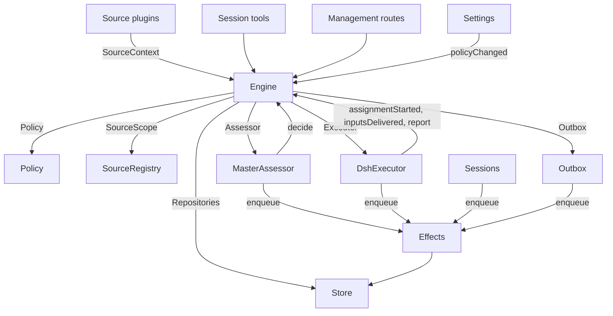

# 007 架构

本文是面向开发者的实现指南。它把 [001 领域模型](001-domain.md) 至 [006 部署](006-deployment.md) 中的概念映射到类、接口与文件。先读 Runtime 与 Engine，再把模块表与测试表当作代码索引使用。

## 核心类与粘合层

核心类在细小接口之后拥有领域概念与外部边界。粘合层把工具参数、HTTP 请求、Source 载荷与 DeepSeek Harness 事件翻译成对这些类的调用，再把结果变成卡片、视图与消息。

`Runtime`（`src/app/runtime.ts`）构建应用、提供依赖，并掌管启动与关闭。`Engine` 自行构造其内部部件。执行器与研判者会回调 Engine，所以 Runtime 给它们的是取值函数，而不是要求按循环顺序构造。

### Runtime

`Runtime` 是组合根，自身不含任何领域规则。其构造函数锁定状态目录、打开 Store 并逐个构建组件。构造失败时，它会关闭 Store 并释放锁。

启动时注册管理路由并运行 Setup。安装完成后，它安装 Session 与执行器钩子、确保主 Session 存在、启动策略同步、恢复被中断的派工，并启动趟处理与副作用。`ready` 标志启动完成。

关闭时取消回合、等待趟、副作用与智能体结束，恢复进程环境，关闭 Store 并释放锁。Source 插件通过狭窄的 `SourceHost` 接口把 Runtime 作为 `orchestrator` 服务注入。

| 部分 | 模块 | 职责 |
| --- | --- | --- |
| Setup | `src/app/setup.ts` | 以执行器 shell 运行 CLI 的方式探测并解析仓库与各账户，写入并应用执行器的环境与命令垫片，并保存安装问题；Settings 经它检查已更改的账户，也经它重启（重启会重新执行安装） |
| Passes | `src/app/passes.ts` | 同一时刻一趟，每两秒一趟，命令请求时也会执行：先处理到期的副作用，再执行 `Engine.evaluateDue`；Source 的触发经它到达 Engine |
| Outbox | `src/app/outbox.ts` | Engine 的 `Outbox` 端口，也是回执的唯一写入者：`send` 在一个事务里保存消息回执并把其 `reply` 副作用入队，副作用的处理器经 `SourceRegistry.send` 发送；Source 未启用时消息等待，会话已消失或未被监听时消息被丢弃 |
| Notices | `src/app/notices.ts` | 把领域事件与执行器活动转换为主 Session 消息。`eventNotice` 处理领域通知；`reportRelay` 立即转发提问，把普通进展留在其工单上，并转送其余报告；`followupRelay` 指出拥有人工跟进的工单。回合期间到达的转送在其下一步经 DeepSeek Harness 收件箱一并投递 |

### Engine

`Engine`（`src/core/engine.ts`）是触发、线程、决定、工单与派工的唯一写入者。它从 `src/core/ports.ts` 接收这些端口：`Repositories`、当前策略取值函数、`SourceScope`、`Assessor`、`Executor` 与 `Outbox`。可选依赖是 `prepareTicket`、`now` 与 `emit`。

Engine 的全部方法都是同步的。每条命令在一个事务里修改其聚合。`evaluateDue` 对其修改的每个评估或工单各用一个独立事务。端口在事务内把外部工作入队；适配器在提交之后执行。无效请求抛出 `UserError`。

Engine 只暴露一个入口，内部委托给五个部件。它掌管每条命令的事务。跨越多个部件的命令，如 `attach`、`evaluateDue` 与 `policyChanged`，按顺序调用各部件。

每个部件都扩展 `EnginePart`（`src/core/part.ts`），后者提供选项与共享读取。部件之间的依赖单向流动：

| 部件 | 职责 | 依赖 |
| --- | --- | --- |
| `Intake` | Source 的触发：与去向一起存储一次，记录到其线程及其关联上，扇出给已订阅的工单；除非它是已到达某个工单的人的消息，否则在其主线程上排队等待评估 | Tickets |
| `Evals` | 线程的评估：分批；准入的强度、行为人与依据及其来源触发（`primary`）；候选投递起算的时限及暂停对其的顺延；过期评估的重新排队；候选、重放与交回；策略变更时的重新排队；以及各自的最终决定：接单、停止、忽略或未完成 | Tickets |
| `Tickets` | 工单生命周期：由一次接单创建，连同其授权、订阅与首个派工；它跟随的线程及其关闭（`followsDone`）；被关联的线程与为上下文而跟随的线程；输入与备注；恢复以及恢复会拒绝的消息；重试、重启、停止与结束；它丢弃的订阅；以及把策略变更通知给受其影响的工单 | Replies |
| `Assignments` | 执行器及其执行器 Session 报告的事实：派工已启动、输入已到达或未到达、重启将其打断，以及执行器 Session 的报告与其对人的提问 | Tickets, Replies |
| `Replies` | 经 `Outbox` 的渠道写入：确认、答复、结果与待人工决定消息，各按允许它的规则发出 | 无 |

命令用祈使式命名，如 `stopTicket`；适配器报告的事实用过去式命名，如 `assignmentStarted`。查询 `candidate` 用名词。

调用者只拿到其角色对应的 Engine `Pick`：`EngineForSources`、`EngineForMainSession`、`EngineForPeople`、`EngineForSettings` 或 `EngineForExecutor`。

| 角色 | 方法 | 效果 |
| --- | --- | --- |
| Sources | `receive(trigger)` | 把触发存储一次，返回 `stored`、`duplicate`，或在没有任何 Source 接收时返回 `filtered`；把它扇出给订阅了其线程的工单——人的消息除非处理被暂停，否则立即恢复已结束的工单；除非它是已到达某工单的人的消息（该消息仍归那个工单），否则在其主线程上排队等待评估 |
| Sources | `bindThread(ticketId, thread, own)` | 让一个开启的工单跟随 Source 的某个线程（例如拉取请求的线程），工单自己开启的记 `own`；已关闭的线程再次绑定后重新开启。结束工单的是线程的关闭，而不是 `ready` 报告 |
| Sources | `threadClosed(thread, outcome, at)` | 线程关闭：每个跟随它的开启工单记录这次关闭，并在处理完其跟随的线程（`followsDone`）后结束——它开启的线程都不再开启；若它未开启过线程，则其跟随的线程全部关闭。工单按其中最近一次关闭的结局以 `merged` 或 `closed` 结束，除非关闭后恢复的工作尚未报告 `ready`，或其执行器已通过确认或答复接手了在其最近一次非 `progress` 报告、或最后一个回合结束之后决定的人工跟进；此时 `dropped` 报告按关闭的结局结束它 |
| 主 Session | `candidate(triggerId)` | 持有某触发的那次评估，按其研判者所见呈现 |
| 主 Session | `candidateDelivered(evalId)` | 评估的候选已到达主 Session：时限从此刻起算 |
| 主 Session | `decide(triggerId, outcome)` | 记录评估决定，或为显式请求记录直接决定。接单会原子地创建工单、授权、派工、订阅与确认。从卡片直接忽略推断候选时，在所给原因之前记录 `ignoredFromCard`。当 `followupOwners` 仍拥有某条人工跟进时，只允许停止 |
| 主 Session | `attach(ticketId, triggerId, note?)` | 把触发路由到它指向的工单，由该工单的执行器作为跟进决定它；同时结束持有它的评估，评估中的其余触发等待新的评估；已结束的工单立即在其授权下恢复，除非处理被暂停。执行器仍在决定的跟进会被拒绝，路由回已交回它的工单同样被拒绝 |
| 主 Session | `requestStatus(ticketId)` | 向等待中的执行器 Session 询问其状态，并回答是否已询问 |
| 主 Session | `note(ticketId, text)` | 把其他工作中的一条事实作为文本输入交给工单的执行器，不授予任何权限 |
| 主 Session, Executor | `reply(request)` | 按消息用途为其渠道排队一条消息：`acknowledgement`、`answer`、`result` 或 `attention` |
| People | `stopTicket(ticketId, reason?)` | 人的停止，撤回授权 |
| People | `retryTicket(ticketId)` | 结束在 `failed` 或 `blocked` 报告后等待人、或输入投递失败（`canRetry`）的工单的停滞派工，并启动新的派工 |
| People | `reevaluate(triggerId)` | 把已存储的触发排队等待一次新评估 |
| People | `unsubscribe(thread)` | 移除一个线程上的全部订阅，跟随它的工单不再跟随；每个工单仍决定其在那里收到的跟进 |
| People | `dismiss(decisionId)` | 消除一条 `unavailable` 决定所显示的问题，决定会记录这一消除 |
| Executor | `assignmentStarted(ticketId, assignmentId)` | 派工开始运行；其等待中的输入随即发出 |
| Executor | `inputsDelivered(ticketId, assignmentId, inputIds)` | 输入已到达派工的执行器 Session，各自等待某个步骤领取 |
| Executor | `inputsRead(ticketId, inputIds)` | 执行器 Session 把携带这些输入的消息纳入其历史（`user/message` Session 事件），其模型由此获得它们；已认领但随后被取消或失败的步骤不算。其后跟随一次报告或回合结束即计为已读，重启之后亦然，工单结束也不放开它；在记录已读之前投递的输入，只要投递后有报告或回合结束，也算已读 |
| Executor | `turnEnded(ticketId, assignmentId)` | 执行器 Session 的回合结束——报告之后亦然——条件是其后台已没有为它运行的工作，或它正在交接给人。步骤此前领取的内容即视为已读（`inputsRead`） |
| Executor | `deliveryFailed(ticketId, assignmentId, error)` | 输入投递失败；工单显示该失败，直到某次投递成功、新派工启动或工单结束 |
| Executor | `report(ticketId, report)` | 记录报告及其对人的提问；`dropped` 结束工单，`ready` 使不跟随线程的工单完成，也使其跟随的线程都已结束时结束 |
| Executor | `markUnrelated(ticketId, thread, reason)` | 只移除该工单对它认为无关的被关联线程的订阅，并把该工单在那里决定的跟进连同原因交回 |
| Executor | `followForContext(ticketId, thread)` | 让开启的工单为上下文订阅一个相关线程：其消息到达工单，但不借出跟进强度，也不恢复工单 |
| Executor | `handback(ticketId, triggerId, reason)` | 记录工单把到达它的触发交回，连同其候选携带的原因；若此前由本工单决定，则在不再有其他工单决定它时排队等待新评估；返回是否已排队。工单对每个触发只交回一次，并保留其订阅 |
| Executor | `assignmentInterrupted(ticketId, assignmentId)` | 宿主停止时有派工正在运行：工作中被打断的、或在其最近报告之后收到过输入的派工，像重试那样带恢复说明重新启动，并重新投递其执行器 Session 未领取的输入；此后已报告过的派工保留其 Session。DshExecutor 在启动时逐个报告（`resume`），最早创建的工单优先，并重新排队仍在等待的启动 |
| Passes | `evaluateDue()` | 除非处理被暂停：为排队触发在等待的线程启动评估，每线程一次，期间排队的触发合并为一批；把超过时限的评估的触发再次排队，连续两次，第三次记录 `unavailable`；并恢复暂停期间被人的消息触及的已结束工单，前提是其授权仍然有效。候选尚未到达主 Session 的评估不过期。处理暂停期间没有评估过期，恢复后每个时限顺延暂停的时长 |
| Settings | `policyChanged(from, to, effects)` | 把变更如何影响每个存活工单告知它（`src/policy.ts` 的 `policyEffects`：其接单所依据的规则已改变或不再适用、其发起者可能不再能发起工作、或不再接受主动工作），并在新版本下重启进行中的评估 |

Engine 把分批、授权、扇出、恢复与待人工决定的生命周期规则保持在内部。若干共享谓词让这些规则保持一致：

- `waitsForPerson`（`src/core/model.ts`）：最近一次派工报告了 `blocked` 或 `failed`，且此后没有人的消息到达。为真期间，自动输入与失败的启动保持扣留。
- `followupOwners`：仍对自己线程上收到的人工跟进负责的工单。工单可以未经人的停止而存活或已结束并等待恢复。交回该消息即结束这种责任。
- `settled`：某个决定已解决该请求；停止、未完成、路由与拒绝停止的决定不算。
- `ticketStage`（`src/core/stage.ts`）：实现 [003 执行](003-execution.md) 中的阶段表。

工单结束时，未读的跟进回到评估，除非另一个工单仍拥有它们，或另一个去向已解决它们。已确认、已答复与已交回的消息除外。对没有确认去向的旧记录，发件箱回执补充这一事实。最终报告也覆盖派工开始时等待中的消息，包括恢复工单的那条。停止工单的那条消息不会自动重新评估。

变更之后，Engine 从 `src/core/ports.ts` 的 `DomainEvents` 发出一个事件：

`trigger.received`, `eval.started`, `decision.recorded`, `ticket.created`, `ticket.resumed`, `ticket.ended`, `assignment.started`, `assignment.ended`, `thread.subscribed`, `thread.unsubscribed`, `trigger.requeued`, or `policy.changed`。

Runtime 把 `ticket.ended`、`trigger.requeued` 与 `thread.unsubscribed` 转成通知。投递给工单的人的 `trigger.received` 成为跟进转送。工单以 merged 或 closed 结束时，`pullEndNotices` 用稳定的 id 发送一条聊天通知。其余事件目前没有消费者。

### Model

`src/core/model.ts` 保存领域类型，`src/core/stage.ts` 保存工单阶段。决定以 `reason` 记录原因，它是 `Reason` 列表（`src/core/reasons.ts`）：每项是一个 `code` 带其 `values`，对批次中的单个触发还带其 `triggerId`。

核心的代码，如 `timeout`、`policyChanged`、`routed` 与 `startedTicket`，属于 `REASONS`，带智能体经 `reasonText` 读到的英文；准入或 Source 范围给出自己的代码，如 `not_a_member`；`said` 携带研判者或人写下的原话。管理面板按 `reason.<code>` 为每个代码措辞，Source 过滤的触发以同样方式记录 Source 的代码。

工单对每项事实只保存一次。没有 `ended` 时它处于开启；`ended` 记录它何时、由谁、为何、以何种结局结束；它最后说的是其最近一次派工报告（`latestReport`）；其执行器 Session 以它命名（`src/executor/dsh.ts` 的 `workerSessionId`）。

其字段是强类型的：`origin`，使其评估批次获得强度的那个可准入触发及批次本身（`triggerId`、`triggerIds`）；`execution`，执行器选择的内容（`name`、`directory` 与 `assignment`）；`delivery`，最近一次失败的输入投递（`error`、`at`），持续到某次投递成功、新派工启动或工单结束；以及 `follows`，Source 让它跟随的线程，每项 `{thread, own, closed?}`：工单自己开启的记 `own`，线程关闭后记 `closed` 带其 `at` 与 `outcome`。只有 Tickets 写 `follows`；GitHub Source 用 `pullsOf` 与 `pullOf` 读取其拉取请求（`src/sources/github-pull.ts`）。

携带触发的输入记录它是否出自人，`waitsForPerson` 读取这一点。线程还在 `context` 中列出只为上下文跟随它的已订阅工单，并在 `expired` 中累计其排队触发的评估连续过期的次数；评估记录其 `primary` 触发及候选何时被 `delivered`。

触发的去向记录它到达了哪些工单（经扇出或关联）、人的重新排队、每个交回它的工单及其原因，以及每个其执行器确认或答复过它的工单。

授权的 `basis`（`MandateBasis`）记录准入以何种依据放行其触发。重新校验读取接收用的 `source`、`scope` 与 `row`，名列出的 `sender`，匹配的 `rules`，以及 `via`：

| `via` | 准入依据 |
| --- | --- |
| `addressed` | 允许名单上的发送者点名了智能体 |
| `followup` | 消息到达了有工单的线程 |
| `admission` | 准入表的一个单元格；`observation` 标记推断候选 |
| `bot` | 名单中的机器人产生了推断候选 |

触发与线程的 `meta` 归 Source 所有。核心不解释它们。

### Policy

`src/policy.ts` 定义设置模式、授权与研判规则。`settingsPolicy(settings, scope)` 每次使用都返回一个全新、无状态的 `Policy`：

- `version`、`paused` 与 `evalTimeoutMs` 描述其当前状态。
- `gate(trigger, thread, tickets)` 返回准入强度与依据。
- `revalidate(mandate)` 检查既有授权是否仍然成立。
- `admitsInferred(rules)` 只在自动（auto）接单模式且存在已启用的匹配规则时允许主动接单。

`assessmentOutcome(assessment, settings, strength)` 把模型的研判转换为 Engine 的结果。它要求每条启用的规则都有判断、方向已定、存在匹配规则，并有意图的证据。自动模式之外，推断的接单变成一条“本会接单”的记录。

`policyEffects(tickets, old, now, scope)` 找出变更影响哪些开启的工单及如何影响。`Engine.policyChanged` 只通知这些工单。`policyVersion` 对规则、接单模式与各 Source 的策略部分（含机器人名单）做哈希。

### Store

`Store`（`src/app/store.ts`）持有一个 SQLite 数据库。Runtime 在打开它之前先取得目录锁，防止第二个进程迁移或写入同一状态。

其接口按用途分组：

- **领域仓储：** `atomic`，以及 `triggers`、`threads`、`tickets` 与 `decisions`，各自带 `get`、`save` 与列表查询。索引工作集是 `threads.active()`、`tickets.open()`、`tickets.active()` 与 `read.subscribedThreads`。
- **读查询：** `read` 经 `threadTriggers`、`triggerStats`、`search` 与 `droppedReplies` 等方法服务视图、工具与 Source 轮询。这些方法从不写入。
- **Source 元数据：** `threads.describe` 与 `threads.patchMeta` 更新 Source 持有的线程元数据。
- **设置：** `settings`、`saveSettings`、`blockRevision` 与 `settingsHistory`。设置与提示词使用编号的 `Versions`（`src/app/versions.ts`）。
- **发件箱回执：** `replyStatus` 与 `receipts`，只由发件箱写入。回执操作是 `get`、`waiting`、`behind`、`add`、`settle` 与 `withdraw`。`behind` 检查同一工单与会话的更早消息是否正以少于三次失败在等待。被撤回的消息以 `channelGone` 或 `channelIgnored` 结清。读查询经 `failingReplies`、`droppedReplies` 与 `droppedSince` 暴露失败与被丢弃的回复。
- **强类型键值记录：** `get`、`set`、`delete` 与 `keys`，使用 `KV` 中的条目。

`afterCommit` 只在事务提交之后运行动作，回滚后绝不运行。Runtime 以存储形态读取记录；schema 11 迁移在启动时转换较旧但仍受支持的记录。

### Effects

`Effects`（`src/app/effects.ts`）是持久化的副作用队列。命令在其事务内调用 `enqueue(kind, key, payload)`；只有提交之后才开始执行。

每个 kind/key 对只有一行。对同一个等待中的键再次入队会替换其载荷并使其立即到期，但不改变队列顺序。`handle(kind, run, options)` 为每个 kind 注册一个处理器。它按最旧优先处理到期行，直至并发上限。

失败按指数退避重试。抛出 `Later` 会推迟工作且不计失败，例如没有空闲执行器槽位时。`start` 在安装完成后开始处理，`drain` 在关闭期间停止处理并保留未完成行，`pending`/`idle` 暴露队列状态。

| Kind | 处理者 | 行为 | 并发 | 重试 |
| --- | --- | --- | --- | --- |
| `assessment` | MasterAssessor | 把评估的候选卡片送入主 Session 的回合，然后告知 Engine 已投递，由此起算评估时限 | 4，暂停时不运行 | 2 秒起加倍至 60 秒 |
| `launch` | DshExecutor | 启动待处理的派工：准备命令、执行器 Session、派工消息 | 空闲执行器槽位全用，暂停时不运行 | 模型提供方或网络的暂时性失败在 5 秒后重试，加倍至 300 秒，至多三次；任何其他失败与失败的准备命令都使其工单失败。因暂停或执行器槽位占满而受阻的，5 秒后再试 |
| `delivery` | DshExecutor | 按顺序把工单等待中的输入交给其运行中的派工 | 4，暂停时不运行 | 2 秒起加倍至 60 秒；等待执行器槽位的 2 秒后再试 |
| `relay` | Sessions | 把执行器 Session 的报告或提问，或人的跟进，送入主 Session 的回合 | 1，按队列顺序 | 2 秒起加倍至 60 秒 |
| `notice` | Sessions | 向主 Session 注入通知而不唤醒它 | 1，按队列顺序 | 2 秒起加倍至 60 秒 |
| `reply` | Outbox | 经其 Source 为渠道发送消息，排在其工单发往同一会话、尚未失败三次的更早消息之后；撤回消息即取消它 | 1，暂停时不运行 | 5 秒起加倍至 300 秒；Source 未启用或排在更早消息之后的 5 秒后再试 |

每个 kind 都有一个以其名字命名的健康条目。其某个副作用连续失败三次即报告错误，`delivery` 例外——其失败显示在对应工单上。转送保持顺序，通知也一样；失败的一条会挡住同 kind 的后续条目。

### Sources

Source 通过 `SourceKind`（定义于 `src/sources/kind.ts`）扩展宿主。kind 声明其身份、标题、描述、配置 `schema` 与 `fields`、派生的 `facts`，以及 `health` 条目。可选行为包括 `scope`、`channel`（`allowed`、`send`、`link`）、`threadContext`、`find`、`policy`、`environment` 与 `refreshLabels`。

`SourceRegistry`（`registry.ts`）持有已注册的 kind 与已存储的实例，并实现 Engine 的 `SourceScope`。注册在 `HealthBoard` 上认领健康条目；重复认领与保留的 `sync:` 名字会被拒绝。SourceContext 只通过其注册所认领的条目写入，因此注销之后的报告不产生任何效果。

Registry 的配置方法包括 `kind`、`instances`、`instance`、`validate`、`validatePolicy`、`policyPart`、`channelAllowed`、`declarations`、`environments`、`find` 与 `scope`。`find` 询问每个支持搜索的 kind。

通用代码经 registry 访问 Source 行为。`send(message, commands)` 经 kind 的渠道发送消息，kind 未安装时返回 `waiting`，目标永远无法接收（或 kind 没有渠道）时返回 `gone`，其余返回 `sent`。`link` 解析其渠道链接。`threadContext` 把 kind 的读取器与其配置配对，kind 没有读取器时不返回。无效的已存配置会禁用该实例。

插件拿到的是 `SourceHost`：registry 与 `context(kind)`。kind 自身使用更窄的 `SourceContext`，由 `src/app/source-context.ts` 的 `sourceContextOf` 构建。

该上下文提供部署与命令、安装就绪状态（`ready`、`configured`、`problem`）、配置、`receive`、`atomic` 与强类型 `state`。它还暴露线程读取与元数据写入、工单读取与绑定/关闭命令、触发读取、经发件箱的 `notify`，以及为已声明健康条目用的 `report`。

### DshExecutor

`DshExecutor`（`src/executor/dsh.ts`）为每个工单提供一个 Session 与一个目录。`start` 与 `deliver` 把 `launch` 与 `delivery` 副作用入队。`stop` 经 `Store.afterCommit` 取消回合，回滚的结束因此不会停掉执行器 Session。

`prepare(ticket, outcome)` 实现 Engine 的 `prepareTicket` 钩子：短名、目录与 `ticketExecution` 派工文本。`workerSessionId(ticket.id)` 推导 Session id。

`WorkerSlots` 在启动之前、或在唤醒空闲执行器的投递之前预留容量。人的消息可以占用 `maxWorkers` 之外的一个槽位，唤醒优先于启动。`activeCount` 供管理面板显示负载。

提供方与网络的暂时性失败重试三次。启动使用副作用退避；失败的回合在 15、30、60 秒后收到续行消息。`inputMessage` 依据工单当前状态渲染每个输入，`mandateInstructions` 为推断工作附加匹配规则的限制。

`install` 订阅 Session 事件；`dispose` 退订。回合结束通常报告等待，就绪之后或需要人工操作时例外。错误报告为失败。启动时，`resume` 经 `assignmentInterrupted` 报告被中断的派工，并把不等待人的待启动项重新排队，最早创建的工单优先。

### MasterAssessor

`MasterAssessor`（`src/app/assessment.ts`）让主 Session 研判主动候选。`request` 把研判副作用入队；`release` 在其评估结束时丢弃缓存状态。

其 `context`、`read` 与 `decide` 方法服务 `orchestrator_eval`、`orchestrator_eval_read` 与 `orchestrator_eval_decide`。它们经 `SourceRegistry.threadContext` 提供有界的线程上下文，提供仓库上下文，并提交决定。没有上下文读取器的 kind 只提供触发与批次。

`assessmentOutcome` 把模型的回答转换为 `Engine.decide` 的输入。评估层会再次对照当前策略检查推断接单。

### Settings

`Settings`（`src/app/settings.ts`）读写带修订号的设置块。`current` 与 `view` 读取它们；`save(block, value, revision, origin)` 校验一次保存；`pause(paused, origin)` 修改单独的 `paused` 设置。

每次保存都声明其来源：`panel`、`tool` 或 `sync`。只有 `panel` 能修改执行环境或 `SETUP_FIELDS`（`src/deployment.ts`）列出的字段。

策略版本变更时计算 `policyEffects`，记录哪些工单被通知，并调用 `Engine.policyChanged`。`syncable` 与 `sync(id)` 刷新 Source 的策略部分。`refreshLabels(id)` 刷新显示名。

### Prompts

`Prompts`（`src/app/prompts.ts`）把配置存为 `Versions`。`current`、`version` 与 `history` 读取它们；`validate`、`preview` 与 `save(value, baseRevision, source)` 校验并保存它们。`compose` 与 `skills` 构建 Session 文本。

`builtInParts` 列出可覆盖键、角色、默认文本与必需的模板占位符。每个覆盖项保存团队 `text` 与一个 `base`：其原始默认的 `builtInBase` 键。保存会把该默认保留在 `KV.prompts.builtIn` 下。`defaultChanged` 随后报告已更改的默认、可用的旧文本，以及已移除的部分。

校验从已保存的覆盖项继承省略的 base，丢弃已存数据中已存在的被移除部分，并拒绝空白文本或其他未知键。这使保存工具能把读到的配置原样回存。`environmentSection` 与 `policySection` 只用自己的键做一次模板值替换。没有覆盖项的配置使用默认。

### Sessions

`Sessions`（`src/app/sessions.ts`）管理两种角色的 DeepSeek Harness Session。`ensure` 以其角色的模型创建 Session。`install` 跟随智能体事件，并为受管 Session 注册提示词、技能与工具。

`prompt` 按请求 id 只投递一次。`relay` 与 `notify` 把主 Session 消息入队，由 `relay` 与 `notice` 副作用处理。`src/app/notices.ts` 定义其内容；`delivery` 检查消息是否已到达。

每次模型请求都把 Session 绑定到当前提示词修订。其使用过的修订被持久保存：`promptVersion` 标识生效的那个，`mayRead` 限制执行器 Session 能查看哪些版本。注册按智能体各记一张映射表。

`status` 与 `promptVersion` 服务提示词页面。保存经 `Prompts.save` 并通知主 Session。`modelRetry` 暴露模型预算重试状态。

### 粘合层

| 粘合层 | 转换 |
| --- | --- |
| `src/app/runtime.ts` | 组合根：以各部件使用的接口构建它们，注册路由与 Source 宿主，并启动和停止 dsh-superagent-cn |
| `src/app/notices.ts` | 领域事件与执行器报告 → 主 Session 的通知与转送 |
| `src/app/tools/main.ts`, `src/app/tools/executor.ts` | 主 Session 与执行器 Session 的工具参数 → 核心类调用，其结果 → 卡片 |
| `src/app/http.ts`, `src/app/views/`, `src/app/api.ts` | HTTP 请求 → 调用，Store 读取 → 管理面板视图；`api.ts` 为面板提供每个路由的类型 |
| `src/app/resources.ts`, `src/app/links.ts`, `src/app/cards.ts` | 资源名 → 读取，Source 消息 → 链接，记录 → 供模型用的紧凑卡片 |
| `src/sources/github*.ts`, `src/sources/feishu*.ts`, `src/sources/poll.ts` | GitHub 与飞书载荷 → 触发与线程事实，消息 → CLI 调用 |
| `src/deployment.ts`, `src/setup.ts`, `src/infra/` | 安装探测与问题、CLI 传输、智能体的进程环境 |

## 依赖规则

- **显式而狭窄的依赖。** 每个类接收一个接口，指明它使用什么，多为其他类的 `Pick` 类型：核心类用 `ExecutorHost`、`AssessorHost`、`SessionsHost`、`SettingsHost`、`SetupHost`、`PassesHost` 与 `OutboxHost`，粘合层用 `HttpHost`、`MainToolsHost`、`ExecutorToolsHost`、`ResourceHost`、`LinkHost` 与 `SourceContextDeps`，Engine 则以调用者角色的 `Pick` 形式出现。Runtime 只在这样的接口之后传递自身。Source 插件注入 `orchestrator` 服务，其类型声明为 `SourceHost`：registry 与 `context(kind)`；kind 的代码只看到自己的 `SourceContext`。
- **谁可以导入谁。** `src/core` 除 Node 的哈希之外不导入自身之外的任何东西，也不做 I/O。`src/sources` 不从 `src/app` 导入。管理面板只从宿主侧导入类型，以及 `src/admission.ts`、`src/limits.ts`、`src/setup.ts`、`src/navigation.ts`、`src/sources/host.ts`、`src/core/errors.ts`、`src/core/reasons.ts` 的纯值与 `src/app/api.ts` 的过滤器列表。
- **每种状态一个写入者。** 每类状态只有一个写入者，其余各方读取它或请求该写入者。

  | 状态 | 写入者 |
  | --- | --- |
  | 触发、线程、决定、工单、派工 | Engine |
  | Source 的读取位置，及其保存在自己线程上的 meta（`label`、`url`、`facts` 与其自有键） | 该 Source，经 `SourceContext` |
  | 设置及其历史 | Settings |
  | 提示词版本 | Prompts |
  | 副作用行 | Effects |
  | 发件箱回执 | 发件箱：Engine 的消息与 Source 的 `notify` 经其 `send`，其 `reply` 副作用标记它们 |
  | 健康条目 | 在 `HealthBoard`（`src/infra/health.ts`）上认领它的那个部件，它拒绝二次认领：`runtime` 归 Runtime（Passes 经它报告），`evals` 归 Runtime（每趟之后），`models` 归 Sessions，每个副作用 kind 归 Effects，`worker` 归 DshExecutor，Source kind 的条目归该 kind 之 Source 的 SourceRegistry，`sync:<id>` 归 Settings |

  Source 只经 `SourceContext.tickets.bindThread` 与 `threadClosed` 修改工单，二者调用 Engine。
- **请求与事实。** 请求某物的方法以祈使动词加宾语命名，如 `stopTicket` 或 `bindThread`，可以被拒绝；记录适配器所为的方法以过去式命名，如 `assignmentStarted` 或 `deliveryFailed`。每个宿主以它所需的角色类型接收 Engine。
- **强类型字段，Source 数据归 Source。** 代码读取工单与授权的强类型字段。Source 不在工单上保存任何东西：工单跟随其哪些线程记录在工单的 `follows`，它关于触发或线程保存的内容在二者的 `meta` 里。
- **固定的拒绝。** 人或智能体可以引发的拒绝是 `src/core/errors.ts` 中 `USER_ERRORS` 的 `UserError(code, values)`。管理 API 对 `missing` 代码回答 404，其余回答 400，管理面板按各自语言为每个代码措辞。安装问题是 `SetupError` 代码（`src/setup.ts`），固定健康文本是 `HealthCode`（`src/sources/host.ts`），措辞方式相同。

### Source 特定的依赖

部分通用模块仍直接引用 GitHub 或飞书：

- 发件箱应用飞书聊天字数上限。
- `src/app/links.ts` 解析飞书消息链接与 `repliedTo`。它与 Runtime 用 `feishuSettings` 读取设置。
- `src/app/resources.ts` 读取 `feishu/` 与 `github/` 原始记录；`src/app/cards.ts` 用 `pullOf` 渲染工单卡片。
- Runtime 为 merged 或 closed 的工单发送 `pullEndNotices`。
- 执行器工具用 `readPull` 与 `claimPull` 绑定已报告的拉取请求，使用 Runtime 暴露的 GitHub 上下文。
- MasterAssessor 用 `readRepositoryPath` 读取仓库文件。
- Sessions 与 Prompts 只为 GitHub 与飞书注册内置技能。Migration 转换它们的 schema-10 记录。
- Setup 只探测 GitHub 与飞书的账户字段（`SETUP_FIELDS`）。只有这些 Source 经 `SourceContext.problem` 收到账户安装问题。

## 模块

| 路径 | 职责 |
| --- | --- |
| `src/admission.ts` `deployment.ts` `index.ts` `kv.ts` `limits.ts` `navigation.ts` `policy.ts` `setup.ts` | 插件顶层：准入表取值；插件部署配置与安装字段；插件入口；`KV` 键值记录家族；人为设置的取值上限；从面板打开 Session 的导航；策略与安装问题定义 |
| `src/core/assignments.ts` `engine.ts` `errors.ts` `evals.ts` `ids.ts` `index.ts` `intake.ts` `memory.ts` `model.ts` `part.ts` `ports.ts` `reasons.ts` `replies.ts` `stage.ts` `tickets.ts` | 核心领域：Engine 入口与五个部件（Intake、Evals、Tickets、Assignments、Replies）、领域类型与端口、工单阶段、错误与原因代码、派生 id、内存仓储（供领域测试）与统一导出 |
| `src/app/api.ts` `assessment.ts` `cache.ts` `cards.ts` `context.ts` `delivery.ts` `effects.ts` `execution-environment.ts` `http.ts` `links.ts` `migration.ts` `notices.ts` `outbox.ts` `passes.ts` `prompts.ts` `resources.ts` `retry-health.ts` `role-models.ts` `runtime.ts` `sessions.ts` `settings-history.ts` `settings.ts` `setup.ts` `skill-files.ts` `source-context.ts` `store-read.ts` `store.ts` `versions.ts` | 应用层：Runtime 组合根、趟调度（passes）、发件箱回执、副作用队列、SQLite Store 与只读查询、schema 11 迁移、设置及其历史、提示词与 `Versions`、Sessions、MasterAssessor 研判、通知与转送、消息投递、模型重试与角色模型、执行环境、文本缓存、卡片、链接与资源、HTTP 管理路由与 `Api` 类型、SourceContext 构建与技能文件 |
| `src/app/tools/executor.ts` `main.ts` `tool.ts` | 两个 Session 角色的工具：`Tool` 类型与两个角色共用的 `orchestrator_read`；主 Session 的工具；执行器 Session 的工具 |
| `src/app/views/overview.ts` `records.ts` `settings.ts` `sources.ts` `text.ts` `threads.ts` `tickets.ts` | 管理面板的视图数据：概览、共享记录行、工单列表与工单页、线程列表与时间线、Source 状态、设置页，以及视图文本的两种形态 |
| `src/client/api.ts` `locales.ts` `markdown.ts` `marks.ts` `prompt-config.ts` `route.ts` `text.ts` | 管理面板的非界面模块：API 调用与轮询、双语文案与 [001 领域模型](001-domain.md) 的术语表、Markdown 子集、状态标记、提示词配置的纯函数、路由与设置分组、按键取词的文案 |
| `src/client/app.tsx` `controls.tsx` `deployment.tsx` `draft.tsx` `eval.tsx` `execution.tsx` `index.tsx` `overview.tsx` `prompts.tsx` `provider.tsx` `rows.tsx` `settings-kit.tsx` `settings.tsx` `source.tsx` `thread.tsx` `ticket.tsx` `trigger.tsx` `widgets.tsx` | 管理面板的 React 界面：面板框架与 Provider、概览、Source、触发、评估与执行各阶段页、线程与工单记录页、设置与提示词、部署页、草稿与保存栏、本地控件、共享部件与共享行 |
| `src/client/client.css` `css.d.ts` | 面板样式表（以文本加载），`css.d.ts` 是其类型声明 |
| `src/executor/background.ts` `dsh.ts` | 执行器实现：DshExecutor、`WorkerSlots` 槽位与派工/输入消息渲染；worker 的后台 shell 任务与子代理的等待、收集与停止 |
| `src/infra/commands.ts` `environment.ts` `health.ts` `paths.ts` `text.ts` | 基础设施：CLI 传输 `Commands`；执行器进程环境与命令垫片；`HealthBoard` 健康看板；包内文件根路径；字数统计与聊天消息上限 |
| `src/sources/admission-context.ts` `feishu-channel.ts` `feishu-image.ts` `feishu-loops.ts` `feishu-read.ts` `feishu-trigger.ts` `feishu.ts` `github-channel.ts` `github-pull.ts` `github-read.ts` `github-trigger.ts` `github.ts` `host.ts` `kind.ts` `poll.ts` `registry.ts` | Source 实现：`SourceKind` 协议、`SourceRegistry`、`SourceHost` 与 `SourceContext` 契约；GitHub 与飞书两个 kind 及其触发翻译、渠道写入、读取、轮询与拉取请求规则；研判用的线程上下文窗口与飞书图片 |

`src/sources/github.ts` 与 `src/sources/feishu.ts` 也是两个 Source 插件的入口，由 `tsdown.config.ts` 构建，并在 `package.json` 中以 `./github-watch` 与 `./feishu-watch` 导出。bundle 的 `cordis.patch.yml` 插入这三个插件，其中飞书默认停用。

## 测试

| 测试 | 覆盖内容 |
| --- | --- |
| `tests/core-engine.spec.ts` | 内存仓储上的领域规则：接收、评估、扇出、恢复与停止、被中断的派工、暂停、策略变更、报告与结局、关联、回复、失败投递与已消除的问题 |
| `tests/stage.spec.ts` | 工单阶段，逐行核对 |
| `tests/policy.spec.ts` | Source 范围、准入、准入表、授权重新校验、策略版本、设置迁移与研判结果 |
| `tests/registry.spec.ts` | `SourceRegistry`：实例、校验、策略部分、渠道与线程上下文 |
| `tests/sources.spec.ts` | 跑在 `SourceContext` 上的飞书与 GitHub Source：翻译、轮询与读取位置、拉取请求规则、健康 |
| `tests/commands.spec.ts` | 以部署账户身份的 CLI 调用、渠道的应答，以及限定仓库的 GitHub 调用 |
| `tests/feishu-read.spec.ts` `github-read.spec.ts` | 飞书与 GitHub 的读取 |
| `tests/admission-context.spec.ts` `feishu-image.spec.ts` | 研判的线程窗口，与飞书图片读取 |
| `tests/assessment.spec.ts` | MasterAssessor 对每次评估保存什么，何时放手 |
| `tests/background.spec.ts` | 等待 worker 的 shell 任务与子代理：唤醒它的结束，与停止的宿主 |
| `tests/bundle-patch.spec.ts` | 按 DeepSeek Harness 的读法解析 bundle 补丁，及其定义的执行器 Session 智能体预设 |
| `tests/effects.spec.ts` | 副作用队列：合并、上限、带退避的重试、健康与关闭 |
| `tests/passes.spec.ts` | 趟：同一时刻一趟，趟运行期间被请求的在其后合为一趟，以及失败趟报告的运行时健康 |
| `tests/outbox.spec.ts` | 运行中 Runtime 上的发件箱：处理暂停或 Source 未安装时消息等待 |
| `tests/cache.spec.ts` | `TextCache` |
| `tests/queue.spec.ts` | Runtime 经副作用队列的工作，以及早期版本存储的内容 |
| `tests/followups.spec.ts` | 工单线程上的人工跟进：发给主 Session 的通知、作用于它的工具、一批涌来的代价；worker 的交回与上下文跟随，以及主 Session 的备注 |
| `tests/health.spec.ts` | 每个部件一条健康条目，各自由自己的下一次成功清除 |
| `tests/delivery.spec.ts` | `AgentDelivery` |
| `tests/retry-health.spec.ts` `role-models.spec.ts` | 模型预算重试，与两个角色的模型 |
| `tests/runtime.spec.ts` | 在模拟的 DeepSeek Harness 宿主上运行整个应用，经工具与 HTTP |
| `tests/tools.spec.ts` | 各 Session 的工具：每个角色的 `orchestrator_read` 读什么，其余主 Session 工具的形态与检查 |
| `tests/runtime-concurrency.spec.ts` | 重叠的工作：趟进行中的触发，投递与启动期间变化的工单 |
| `tests/http.spec.ts` | 同源与环回检查、每类失败的状态码、请求体上限、路径参数与查询 |
| `tests/settings.spec.ts` | 与模型或账户检查赛跑的设置保存、被保存反超的策略同步，以及暂停、同步与封锁的拒绝 |
| `tests/views.spec.ts` | 管理视图从 Store 推导什么，例如被丢弃消息所属的线程 |
| `tests/timeline.spec.ts` | 线程分页与触发邻居，按时间再按 id 排序，所有已接收触发的时间统一为一种形式 |
| `tests/migration.spec.ts` | schema 11 迁移：每条存储记录都是当前形态，并拒绝更旧的 schema |
| `tests/store.spec.ts` | 仓储及其工作集，SQLite 与内存一致；kv 区域（`KV` 的每个键只在 `src/kv.ts` 与迁移中出现）；设置历史与查询 |
| `tests/prompts.spec.ts` | 提示词校验、组装与版本 |
| `tests/cards.spec.ts` | 内置文本必须陈述的规则，逐文件核对 |
| `tests/model-surface.spec.ts` | 模型读到的一切：工具、提示词、技能与输入，对照工具模式、执行环境与术语表核对，并受每角色尺寸预算约束 |
| `tests/deployment.spec.ts` `environment.spec.ts` `index.spec.ts` | 插件配置与安装、智能体的进程环境、插件入口 |
| `tests/service-script.spec.ts` | 用假的 `ps`、`tmux` 与 `dsh` 测试 `scripts/dsh-superagent-cn` |
| `tests/client.spec.tsx` `navigation.spec.ts` `controls.spec.tsx` | 客户端插件的注册与轮询、Session 导航与路由记忆、本地控件，以及管理面板的导入（无循环依赖） |
| `tests/panel-overview.spec.tsx` `panel-source.spec.tsx` `panel-trigger.spec.tsx` `panel-eval.spec.tsx` `panel-execution.spec.tsx` | 管理面板的每个页面，对着按路由应答的假管理 API |
| `tests/panel-settings.spec.tsx` `panel-prompts.spec.tsx` `panel-deployment.spec.tsx` `panel-panel.spec.tsx` | 设置分组、草稿与历史、提示词、部署页，以及面板的搜索、术语表与路由记忆 |
| `tests/draft.spec.ts` `prompt-config.spec.ts` `markdown.spec.ts` `marks.spec.ts` | 草稿状态、合并与保存栏文案；按分节的提示词配置与行级差异；Markdown 子集及其链接；视图所分类的每种状态的标记 |
| `tests/locales.spec.ts` `styles.spec.ts` | 双语文案与样式表 |
| `tests/class-docs.spec.ts` | `src` 中每个类前面都有 JSDoc 块 |
| `tests/docs.spec.ts` | 编号文档只链接更早的文档、每个本地链接可解析、没有文档含合并冲突标记，且本文档的模块表与测试表列出每个模块与每个测试 |

`tests/fixtures/` 保存多个测试共享的内容：`host.ts`，模拟的 DeepSeek Harness 宿主；`panel-server.ts` 与 `panel.tsx`，假管理 API 及包住页面的面板；`deployment.ts`，一份已解析的部署；`git.ts`，测试启动的每个 git 的环境，不点名任何仓库；以及 `async.ts`。

## 持久化

一个 SQLite 文件 `<stateDir>/orchestrator.sqlite`，只有 Store 打开它。

| 表 | 保存内容 | 写入者 |
| --- | --- | --- |
| `trigger` | 每个触发，其时间 `at` 统一为 `Date#toISOString` 给出的形式，由 Engine 接收时写入，因此时间可按文本比较 | Engine |
| `disposition` | 每个触发的去向：`filtered` 带 Source 的原因代码，其评估与决定，它到达的工单（经扇出或关联），是否被重新排队，交回它的工单及其原因，以及其执行器确认或答复过它的工单 | Engine |
| `trigger_thread` | 每个触发在哪些线程上，带其时间与是否出自人，使线程的触发无需扫描全部触发即可按时间再按 id 的顺序读取：线程时间线的一页从 `<at>|<id>` 游标继续，共享同一时间的触发不会被跳过 | Store，随每个触发一起 |
| `thread` | 线程：订阅、为上下文跟随它的工单、排队触发、进行中的评估、过期计数与 `meta`；生成列 `active`（触发排队或评估运行期间置位）与 `subscribed`（工单订阅期间记其 Source） | Engine；Source 写 `meta` |
| `ticket` | 工单及其授权、origin、execution、派工、渠道、输入与跟随的线程；生成列 `open`（未结束期间置位）与 `active`（输入未投递、或最近派工待启动或运行中期间置位） | Engine |
| `decision` | 决定，按线程 | Engine |
| `effect` | 副作用队列：按 kind 与键保存载荷、顺序、带最近错误的失败尝试，以及到期时间 | Effects；schema 11 迁移把早期版本为主 Session 保存的内容入队 |
| `outbox` | 每个渠道消息按 id 的回执，带其所属工单与 `status`（`pending`、`sent` 或 `dropped`），保证一个 id 永不排队两次；被丢弃的消息记录何时与为何，即生成列 `dropped` 的时间与原因代码。等待中的消息有一个持有其尝试次数的 `reply` 副作用 | 发件箱 |
| `kv` | 其余全部记录，按键 | 命名它的部件 |

生成列由其行的 JSON 计算，在集合之外为空，每个都有覆盖其集合的索引，因此一趟只读活跃工作。早于某列的数据库在 Store 打开时补上该列。

`KV`（`src/kv.ts`）定义每个键值记录的拥有者、键与类型。所有读写方都使用这些条目；只有迁移代码提及旧键。

| 记录 | 键或内容 |
| --- | --- |
| Schema | 当前 schema 版本 |
| 设置版本 | `settings-revision`、`settings-version:<n>`、`settings-block-revision:<block>`；快照包含来源、策略版本与受影响的工单 |
| 提示词版本 | `prompt-revision`、`prompt-version:<n>` |
| 主 Session | `master-id` |
| Session 提示词历史 | `session-prompts:<session id>` |
| Source 状态 | 读取位置（如 `github-cursor:<number>`）、PR CI 指纹与已见的飞书话题消息；键以 kind 或 `thread-` 加线程键开头 |
| 显示名 | `source-labels:<source id>` |

消除记录在其决定上。输入文本在读取时从工单渲染，因此二者都不需要单独的键值记录。

读缓存使用有界的内存 `TextCache` 实例，重启即丢失。Session 分页浏览 Source 原始记录或提示词预览时，重启后必须从 offset 0 重读。接入之后解析的飞书链接以同样方式缓存；基于链接的搜索只有在该链接于当前进程存活期内被读过之后才能找到它们。

目前没有任何机制删除旧记录，因此以下内容无界增长：`trigger`、`disposition` 与 `decision` 行；已结束的工单及其线程；发件箱回执；以及 `kv` 中的每次已保存设置修订与提示词版本、每个 Session 使用过的提示词修订，以及 Source 按线程、按 Issue 与拉取请求保存的记录。

`SCHEMA_VERSION` 只增不减。更新版本的数据库拒绝启动；`src/app/migration.ts` 在启动时把预发布 schema 10 的数据库升级一次，并拒绝更旧的。

## 面向模型的接口

### 主 Session 工具

主 Session 有 14 个应用工具：

| 用途 | 工具 |
| --- | --- |
| 读取与路由 | `orchestrator_read`, `orchestrator_route` |
| 管理工单 | `orchestrator_ticket_retry`, `orchestrator_ticket_request_status`, `orchestrator_ticket_note` |
| 重新评估 | `orchestrator_trigger_requeue` |
| 研判主动工作 | `orchestrator_eval`, `orchestrator_eval_read`, `orchestrator_eval_decide` |
| 沟通与取消订阅 | `orchestrator_reply`, `orchestrator_thread_unsubscribe` |
| 配置 | `orchestrator_settings_save`, `orchestrator_policy_sync`, `orchestrator_prompts_save` |

`orchestrator_route` 按顺序接受 1–20 条决定。每次接单、关联、停止或忽略都作为独立的 Engine 命令运行。它也允许直接从卡片忽略一个推断候选。`orchestrator_ticket_note` 发送的是作为上下文的事实，不是授权。

设置保存选择 `policy`、`eval`、`executor`、`pause` 或 `source`；最后一种还要给出其 Source id。带 `preview: true` 的提示词保存只组装文本，不落盘。

主 Session 还有 DeepSeek Harness 的 `skill`、`bash`、`read`、`read_image`、`job_output`、`job_list` 与 `job_kill`。避免读代码是提示词规则，不是工具限制。

### 预设与等待限制

新的主 Session 使用 `dsh-superagent-cn-router`（`ROUTER_PRESET`）。Shell 命令与任务等待 5 秒后返回。如果 Web UI 在首个回合之前选了别的预设，`Sessions` 会恢复该预设；执行器 Session 则恢复 `WORKER_PRESET`。

`src/app/sessions.ts` 中的 `noWait` 守卫拒绝主 Session 在命令位置调用 `sleep` 的 shell 命令、超过 30 秒的 shell `timeoutMs`，以及超过 5 秒的 `job_output` 等待。报告与任务结果会自动到达，等待只会拖慢到来的候选。

在 `standard` 预设上的既有主 Session 也需要为前台命令与任务等待显式设置超时；否则该预设的默认值会把步骤分别扣住 60 秒与 30 秒。宿主经 `presetForSession` 判定当前预设，回退到 Session 投影或头信息，读不到时按 `standard` 处理。

### 执行器工具

每个执行器有六个应用工具：

| 工具 | 用途 |
| --- | --- |
| `orchestrator_read` | 读取其工单可用的资源 |
| `orchestrator_ack` | 确认一个请求 |
| `orchestrator_report` | 报告进展或结局，并按拉取请求规则绑定拉取请求 |
| `orchestrator_thread_unrelated` | 移除无关的被关联线程，交回其拥有的人工跟进，并告知主 Session 原因 |
| `orchestrator_thread_follow` | 为上下文订阅相关线程，并告知主 Session |
| `orchestrator_trigger_handback` | 把一条消息交回一次，附其候选携带的原因 |

如果另一个工单仍拥有该消息，或本工单从未拥有它，交回返回 `queued: false`。例如机器人的消息独立进入了评估。

worker 预设定义在 `cordis.patch.yml`，经 `WORKER_PRESET` 选择。`src/app/sessions.ts` 的 `WORK_TOOLS` 保留可用的文件、搜索、shell、任务、web、技能、todo 与子代理工具。执行器 Session 不会拿到这些工具：向人提问或展示、修改 profile、在执行器槽位之外安排工作、启动其他 Session 或与其通信、编辑外部文档。工单结束之后工具调用会被拒绝。

### 结果形态与研判上下文

路由结果使用 `{decision?, reason, ticket?}`。`orchestrator_route` 返回 `{results}`，保持条目顺序并为每条附加 `trigger_id` 与 `kind`。无效或被拒绝的条目返回 `refused` 与原因，不打断整批。

设置与提示词保存返回已保存的配置。策略同步返回 Source、允许名单大小，以及 `added` 与 `removed` 的名字。

`orchestrator_eval` 返回上下文而非指令。研判指令在 `runtime/admission`（`prompts/admission.md`），规则在 `runtime/policy`。其上下文包括：

- 触发文本，至多 4,000 字符，带图片 id 与批次中的其他触发。
- 至多八个 `related_tickets`，开启的在前，以及 `tickets_total`。
- 评估的 `policy_version`。
- 线程窗口：前五条消息与触发两侧各五条。消息用 `{id, from, at, text}`，通常限 400 字符，触发两侧那两条限 1,200。被截断的消息带 `chars`；图片引用用 `images`。
- 其余已加载消息以 50 字符的 `{id, from, preview}` 摘要出现。`orchestrator_eval_read` 按 id 展开它们。

工单卡片使用 `src/app/cards.ts` 的封闭集合 `TICKET_STATES`：开启阶段如 `person/review` 或 `working/queued`，或已结束的结局。确认无论经接单、研判还是 `orchestrator_ack` 提交，都限 100 词。

### 读取资源

`src/app/resources.ts` 的 `RESOURCES` 定义资源，并生成工具的 `resource` 描述。

| 资源 | 内容 |
| --- | --- |
| `tickets`, `triggers`, `threads`, `decisions` | 分页列表 `{items, next_offset}`；活动列表最新在前 |
| `decision/<id>` | 一条决定 |
| `thread/<key>` | 标签、工单、近期决定与一页触发 |
| `trigger/<id>` | 消息文本、所回复的触发与相邻消息，不含 CI 运行 |
| `ticket/<id>` | 相关 id、来源批次的触发、线程，以及派工与输入的首页 |
| 工单子资源 | `/assignments`, `/inputs`, `/assignment`, `/result`, `/report/<assignment id>`, `/transcript`, `/message/<n>`, `/input/<id>` |
| `settings`, `settings/<block>` | 修订与摘要，或一个可直接保存的完整块 |
| `prompts`, `prompts/<revision>`, `prompts/current`, `prompts/defaults`, `prompt-preview/<id>` | 提示词配置与组装后的文本 |
| `models`, `models/<provider>` | 可用模型 |
| `feishu/<trigger id>/…`, `github/…` | Source 原始记录，由 Source 技能描述 |

工单的线程标记为 `context`（只为上下文跟随）与 `bound`（Source 绑定）。派工页最新在前，含报告预览。用 `next_offset` 续读列表。`/input/<id>` 接受输入的名字或 id。`settings` 完整包含小块，并摘要策略与 Source 块。

Source 资源包括消息邻域、`github/pulls/<n>/thread/<comment id>` 与 `github/commits/<sha>/checks`。

原始记录的消息以统一的紧凑形态 `{id, from, at, text, reply_to?, path?, line?, url?}` 读取，而非 GitHub 或飞书各自的记录格式。

执行器 Session 只读自己的工单、其线程、到达它或其请求持有的触发、其使用过的提示词版本与原始记录；其页面省略它读不到的内容的 id、决定与其他工单。

页面显示的每个 id 都可经其中某个资源读取，Session 因此能从一个对象走到下一个；而无处用于读取的哈希（例如评估的 id 或策略版本）不进入页面。

文本页默认 4,000 个 UTF-16 码元、至多 8,000；列表默认 20 项、至多 50。

早期版本的 `event/`、`task/` 与 `observation/` 名字仍然可解析。

### 投递给 Session 的消息

以下消息被送入主 Session 的回合：

| 消息 | 内容 |
| --- | --- |
| 候选 | 批次触发卡片、线程、`related_tickets`、`tickets_total`、`delivered_to`、从 Issue/PR 链接解析出的工单、`handed_back` 原因与下一步动作 |
| `follow_up` | 执行器所见的那条消息、`replies_to`、接收的工单，以及提醒：由执行器决定，主 Session 只能停止工作 |
| `worker_report` | 工单卡片、来源触发、状态与至多 600 字符的摘要；被截断时带 `chars` 与读取指针 |
| `worker_attention` | 携带提问的工单卡片 |

其余通知不唤醒主 Session 直接注入：`ticket_ended`、`settings_saved`、提示词保存、触发重新排队、取消订阅与上下文跟随。设置通知给出块名、变更路径与 `read: settings/<block>`。主 Session 自己执行的保存、重新排队、取消订阅或关联不会收到多余的通知。

执行器 Session 内联接收派工与输入。首条消息包括标题、至多 1,500 字符的派工文本与来源触发卡片。输入携带至多 600 字符的触发卡片与 `replies_to`，或纯输入文本。读取指针只对被截断的内容出现。

### 仅管理面板可执行的操作

没有工具可以消除一条未完成决定、重新运行安装、刷新 Source 显示名，或把执行器拥有的人工跟进送去评估。最后一项被 `orchestrator_trigger_requeue` 刻意拒绝。管理面板的其余操作都有等价工具。

多数内置指令在 `prompts/*.md`，一句一行，由 `promptFile` 拼接。Source 技能在 `skills/dsh-superagent-cn-*/SKILL.md`。工具描述与固定通知（如重启恢复说明）仍在代码里。研判指令只在 `prompts/admission.md`。

`tests/model-surface.spec.ts` 检查这些界面是否漂移。[004 提示词](004-prompts.md) 解释团队可编辑的部分。

## 配置热重载

除 `stateDir` 外的每个插件配置键都是易失的。管理面板的部署设置与 DeepSeek Harness 的插件管理器经 DeepSeek Harness 的配置表单编辑它们；宿主写入 `cordis.patch.yml` 并就地更新取值，dsh-superagent-cn 在用到每个上限时才读取，因此变更无需重启即生效。

更改安装所读 Source 字段（例如账户的 CLI）的设置保存，以及安装等待期间的任何保存，都会重启 dsh-superagent-cn。重启期间 DeepSeek Harness 的设置服务不提供该条目，因此 dsh-superagent-cn 在自身重启后会请它重新读取该条目，打开的表单随之恢复可编辑。

## 用真实数据审查变更

把 `DSH_HOME` 指向一个临时目录并在其中新建 profile。从备份复制数据库，停用全部 Source，暂停处理并移除主 Session id。给 GitHub 与飞书 CLI 配上只读替身。

## 待解决问题

- 信任：哪些触发字段可信（例如 Source 的行为人与线程成员关系），哪些不可信（例如正文与引用）。
- 部署隔离：智能体的 profile 用它自己固定的那份 DeepSeek Harness 安装，别处升级 DeepSeek Harness 不会破坏它。
